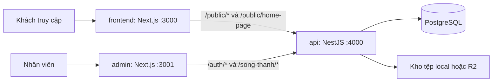
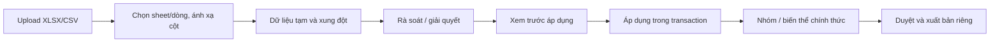

# Audit hiện trạng hệ thống Web Song Thanh

**Ngày đối chiếu:** 26/10/2026 (Asia/Saigon)

**Phạm vi:** source trong checkout ở thời điểm đối chiếu, trước khi đóng gói commit.
**Trạng thái:** bản kiểm kê kỹ thuật phục vụ chuẩn bị LVTN, **chờ người dùng xác nhận** trước khi dùng làm đặc tả nghiệp vụ hoặc nguồn sự thật cho khóa luận.

## 1. Cách đọc và mức độ chứng cứ

| Ký hiệu | Ý nghĩa | Có thể kết luận |
| --- | --- | --- |
| **Mã nguồn** | Route, controller, service, repository, DTO, migration và test hiện có | Hệ thống được lập trình để xử lý theo nhánh đó; chưa chứng minh mọi nhánh đã chạy trên môi trường bàn giao. |
| **Kiểm thử 26/10** | Lệnh được chạy trong lần audit này, ghi ở mục 10 | Kết quả đúng cho worktree và database local tại thời điểm chạy. |
| **Biên bản cũ** | Nhật ký trong `tasks/` và bản phân tích mới trong `docs/` | Bằng chứng theo thời điểm ghi; phải kiểm tra lại nếu code đã đổi. |
| **Cần xác nhận** | Quy tắc/mục tiêu không thể rút ra chắc chắn từ code | Chưa đưa vào yêu cầu chính thức của LVTN. |

Không dùng thư mục `docs/` đã xóa trong lịch sử Git, tên bảng cũ hay kế hoạch thiết kế để suy ra chức năng hiện hành. Ba file `docs/workflowAnalysis.md`, `docs/workflowEvidence.md`, `docs/workflowProposal.md` đang là **bản thảo mới trong worktree**, không phải tài liệu cũ đã bị xóa và chưa được duyệt. Những thay đổi ở contact/quote, trang chủ và một số component hiện chưa commit cũng thuộc phạm vi kiểm kê này.

## 2. Tóm tắt để định phạm vi đề tài

Hệ thống hiện gồm **website công khai**, **website quản trị độc lập**, **NestJS API** và **PostgreSQL**. Website giới thiệu doanh nghiệp, danh mục và chi tiết sản phẩm, thương hiệu, dịch vụ, dự án, tin tức; khách có thể gửi liên hệ hoặc yêu cầu tư vấn/báo giá. Admin quản lý dữ liệu, nội dung, tệp, nhập bảng tính, yêu cầu khách hàng, tài khoản, quyền và nhật ký. Code hiện tại không có luồng giỏ hàng, đặt hàng, thanh toán hoặc lập báo giá thương mại chính thức.

| Thành phần | Vai trò thực tế | Điểm vào/source chính |
| --- | --- | --- |
| `frontend/` | Website công khai, route Next App Router, xem nội dung và gửi form | [`frontend/src/app/`](frontend/src/app/), [`frontend/src/proxy.ts`](frontend/src/proxy.ts), [`frontend/src/features/`](frontend/src/features/) |
| `admin/` | Giao diện cho nhân viên theo quyền, có màn preview và nhập/xuất | [`admin/src/app/`](admin/src/app/), [`admin/src/features/`](admin/src/features/), [`admin/src/lib/api-client.ts`](admin/src/lib/api-client.ts) |
| `api/` | Xác thực, kiểm quyền, nghiệp vụ, public API, truy cập DB/kho tệp | [`api/src/main.ts`](api/src/main.ts), [`api/src/app.module.ts`](api/src/app.module.ts), [`api/src/modules/`](api/src/modules/) |
| `database/`, `api/migrations/`, `api/seeds/` | Snapshot DDL, lịch sử thay đổi schema, dữ liệu nền | [`database/ddl/`](database/ddl/), [`api/migrations/`](api/migrations/), [`api/seeds/`](api/seeds/) |
| `scripts/qa/`, `admin/tests/`, `api/tests/`, `frontend/tests/` | Bộ kiểm tra tĩnh, unit, smoke và E2E | [`scripts/qa/`](scripts/qa/), [`admin/tests/e2e/`](admin/tests/e2e/) |

Ba package độc lập dùng Next.js 16/React 19 cho hai UI, NestJS 11/Knex/PostgreSQL cho API; phiên bản chính xác và lệnh chạy lấy từ [`frontend/package.json`](frontend/package.json), [`admin/package.json`](admin/package.json), [`api/package.json`](api/package.json). API trả dữ liệu cho hai origin, có validation toàn cục, bộ lọc lỗi, response interceptor, CORS, security headers và throttling trong [`api/src/main.ts`](api/src/main.ts), [`api/src/app.module.ts`](api/src/app.module.ts). Đây là kiến trúc triển khai trong code; không khẳng định cấu hình VPS/staging vì chưa kiểm tra môi trường đó.

### Số liệu kiểm kê 26/10

Chạy [`scripts/qa/generate-system-inventory.mjs`](scripts/qa/generate-system-inventory.mjs) trên source hiện tại; bản phát sinh nằm ở `tmp/qa-artifacts/generated/system-inventory.md` (thư mục tạm, không là đặc tả):

| Chỉ tiêu | Số lượng | Cách hiểu |
| --- | ---: | --- |
| API endpoint | 221 | Đếm decorator controller, gồm public, auth, admin, health và thao tác con. |
| Route Admin | 47 | Đếm `page.tsx`, gồm login, trang từ chối truy cập, trang điều hướng và chi tiết. |
| Route Frontend | 19 | Đếm `page.tsx`, gồm hai route preview dành cho Admin. |
| Mã quyền | 118 | Permission catalog trong seed, controller và hằng số Admin khớp theo script. |
| Vai trò được seed | 5 | `super_admin`, `content_admin`, `product_admin`, `sales_admin`, `viewer`; code cho tạo vai trò tùy chỉnh. |
| Migration | 48 | File có thứ tự trong `api/migrations/`; local DB ghi nhận áp dụng đủ 48. |
| Bảng | 62 | Snapshot DDL và DB local có cùng tập bảng sau migration; gồm bảng kỹ thuật/legacy, không phải 62 chức năng. |
| DTO class / field | 134 / 729 | Chỉ là độ rộng hợp đồng đầu vào, không đại diện use case. |

Quy mô file nguồn theo `rg --files` tại thời điểm audit: `api/src` có **243** file `.ts`, `admin/src` **184** file `.ts/.tsx`, `frontend/src` **157** file `.ts/.tsx`. Bộ kiểm thử có **35** file API unit, **9** file Admin unit, **13** file Frontend test và **46** file Admin Playwright `.spec.ts`; `scripts/qa` có **29** file tiện ích/fixture. Đây là số file, không phải số chức năng đã hoàn thành hay số ca đã chạy.

## 3. Tác nhân, quyền và các trạng thái phải tách riêng

**Khách truy cập** không cần tài khoản: đọc dữ liệu qua `/public/*`, gửi hai loại form. **Nhân viên Admin** đăng nhập qua `/auth/*`; request quản trị qua `/song-thanh/*` kiểm tra `AuthGuard` + `PermissionGuard` theo mã quyền tại controller. `super_admin` có quyền chốt `approved/rejected/published` qua [`WorkflowApprovalGuard`](api/src/common/workflow/workflow-approval.guard.ts). Việc tài khoản chỉ có đúng một vai trò active và quyền được kiểm tra lại theo trạng thái hiện hành nằm ở [`api/src/modules/auth/`](api/src/modules/auth/), [`api/src/modules/admin-user/`](api/src/modules/admin-user/), migration [`202610010001_oneUserRole.js`](api/migrations/202610010001_oneUserRole.js). UI ẩn/khóa thao tác theo quyền nhưng ranh giới bảo vệ cuối cùng là API.

| Trục | Giá trị điển hình | Áp dụng / ý nghĩa |
| --- | --- | --- |
| Duyệt nội bộ `review_status` | `draft`, `pending_review`, `approved`, `rejected` | Sản phẩm, biến thể, trang nội dung, trang thương hiệu, dịch vụ, dự án. |
| Hiển thị `publish_status` | `unpublished`, `published`, `archived` | Nội dung có thể đã duyệt nhưng chưa hiển thị. Public API còn kiểm tra quan hệ/tham chiếu. |
| Khả dụng `status` | `active`, `inactive` | Danh mục, thương hiệu, sản phẩm, biến thể, banner và vài đối tượng khác; không thay thế duyệt/xuất bản. |
| Lưu trữ `deleted_at` | `NULL` hoặc thời điểm | Soft delete/restore ở đa số module. Xóa vĩnh viễn chỉ ở endpoint/điều kiện được chỉ rõ. |
| Xử lý yêu cầu | `new`, `in_progress`, `done`, `spam`, `invalid` | Contact và quote; không có quan hệ với duyệt nội dung. |
| Lô nhập | `created`, `validated`, `in_review`, `ready_to_apply`, `applied`, `cancelled` | Tiến độ nhập Excel/CSV; dòng tạm có `pending_review/approved/rejected/applied` riêng. |

Nguồn kiểm tra: [`public.repository.ts`](api/src/modules/public/public.repository.ts) lọc trạng thái trước khi cấp dữ liệu, [`import-workspace.types.ts`](api/src/modules/import-workspace/import-workspace.types.ts), [`contact.types.ts`](api/src/modules/contact/contact.types.ts), [`quote.types.ts`](api/src/modules/quote/quote.types.ts). **Duyệt dòng nhập không phải duyệt sản phẩm để công khai.** **Bản ghi Trang nội dung của `/san-pham` chỉ sở hữu phần biên tập**, không tắt route, danh mục hay banner do module khác sở hữu.

## 4. Bản đồ chức năng và chủ sở hữu dữ liệu

| Nhóm chức năng | Khách thấy / thao tác | Admin quản lý | Nguồn API và dữ liệu chính |
| --- | --- | --- | --- |
| Trang chủ, header/footer | Xem banner, khối nổi bật, menu, công ty, CTA | `home-page`, `menu`, `website-settings`, `banners`; nội dung trang riêng | [`home-page`](api/src/modules/home-page/), [`public`](api/src/modules/public/); `home_section`, `menu`, `company_info`, `banner` |
| Danh mục và tìm sản phẩm | `/san-pham`, `/san-pham/danh-sach`, `/san-pham/[slug]`, `/tim-kiem`; lọc, sắp, xem biến thể, giá hoặc liên hệ | Danh mục 2 cấp, thương hiệu, nhóm sản phẩm, biến thể, ảnh, thông số, tài liệu | [`product-category`](api/src/modules/product-category/), [`brand`](api/src/modules/brand/), [`product-group`](api/src/modules/product-group/), [`product-variant`](api/src/modules/product-variant/), [`technical-document`](api/src/modules/technical-document/); `product_*`, `variant_attribute` |
| Thương hiệu | Danh sách/chi tiết, sản phẩm liên quan | Bản ghi brand và trang chi tiết brand riêng | [`brand-page`](api/src/modules/brand-page/), [`public`](api/src/modules/public/); `brand`, `brand_page`, nguồn/số liệu/sản phẩm nổi bật |
| Dịch vụ và dự án | Danh sách/chi tiết, gallery, sản phẩm liên quan, CTA | Hồ sơ dịch vụ/dự án, gallery và quan hệ sản phẩm | [`service`](api/src/modules/service/), [`project`](api/src/modules/project/); `service`, `project`, bảng liên kết |
| Tin tức, trang thông tin | Tin tức/chuyên mục, `/gioi-thieu`, `/ho-so-nang-luc`, route `/<slug>` | `page-contents`, `news-category`; preview trước khi xuất bản | [`page-content`](api/src/modules/page-content/), [`news-category`](api/src/modules/news-category/); `page_content`, `news_category` |
| Liên hệ | Form liên hệ | Hộp thư, phân công, ghi chú, trạng thái, lưu trữ | [`contact`](api/src/modules/contact/), [`public`](api/src/modules/public/); `contact_request`, `contact_internal_note` |
| Tư vấn/báo giá | Form chung hoặc gắn nhiều sản phẩm/biến thể và số lượng | Hộp thư quote, dòng hàng, người xử lý, ghi chú | [`quote`](api/src/modules/quote/), [`public`](api/src/modules/public/); `quote_request`, `quote_item`, `quote_internal_note` |
| Hồ sơ khách | Không có cổng đăng nhập khách | Tạo/sửa/tra cứu hồ sơ và lịch sử liên hệ/báo giá | [`customer`](api/src/modules/customer/); `customer_profile` |
| Nhập/xuất | Không thao tác | Intake Excel/CSV, chọn sheet/dòng, mapping, rà soát, áp dụng; tải bảng tính | [`import-workspace`](api/src/modules/import-workspace/), [`ImportWorkspacePage`](admin/src/features/import-workspace/ImportWorkspacePage.tsx), [`CustomerListPage`](admin/src/features/customer/CustomerListPage.tsx) |
| Vận hành khác | Banner, tệp được cấp, URL chuyển hướng | Tệp, banner, redirect, dashboard, nhật ký, user/role | [`file`](api/src/modules/file/), [`banner`](api/src/modules/banner/), [`redirect`](api/src/modules/redirect/), [`dashboard`](api/src/modules/dashboard/), [`audit-log`](api/src/modules/audit-log/) |

Danh mục route cụ thể và ma trận 29 workflow có thêm link nguồn trong [`docs/workflowEvidence.md`](docs/workflowEvidence.md). Bảng trên phân biệt **đọc công khai** với **quản trị nguồn dữ liệu**; một màn công khai thường ghép dữ liệu từ nhiều module.

## 5. Workflow hiện có: tác nhân, trình tự và kết quả

Các mã WF dưới đây giữ cùng cách đánh số với [`docs/workflowAnalysis.md`](docs/workflowAnalysis.md) để tra từng bước và nhánh lỗi. Chúng là **nhóm hành vi quan sát được**, chưa phải danh sách use case đã được nhà trường hoặc doanh nghiệp duyệt. Một workflow có thể gồm nhiều endpoint và nhiều màn hình; tạo/sửa/lưu trữ là bước trong cùng mục tiêu, không tự đếm thành workflow riêng.

| WF | Tác nhân, điểm bắt đầu | Luồng chính và kết quả | Nhánh cần nhớ |
| --- | --- | --- | --- |
| 01 Điều hướng | Khách mở website | Nạp site shell, menu, bố cục trang chủ; chọn liên kết để tới nội dung. | Menu active vẫn có thể lược liên kết đến trang hệ thống chưa công khai; khối tắt không tự hiện. |
| 02 Tìm/xem sản phẩm | Khách chọn danh mục/từ khóa | Lọc, sắp, phân trang; mở nhóm sản phẩm, chọn biến thể, xem giá/ảnh/tài liệu. | Nhóm và biến thể phải qua điều kiện công khai riêng; giá có thể là “liên hệ báo giá”. |
| 03 Xem nội dung | Khách mở thương hiệu, dịch vụ, dự án, tin tức, trang | API chỉ trả bản ghi được phép công khai; UI hiển thị khối dữ liệu hiện có. | 404 khi slug không công khai; trang hệ thống và module con có chủ sở hữu trạng thái khác nhau. |
| 04 Tệp công khai | Khách mở ảnh/tài liệu | API kiểm tra tệp gắn nội dung hợp lệ rồi cấp tệp; ảnh sản phẩm được xử lý watermark. | Tệp tồn tại trong thư viện không tự có quyền công khai. |
| 05 Gửi tư vấn/báo giá | Khách mở form chung/ở sản phẩm | Điền liên hệ, bối cảnh dự án, nhiều dòng sản phẩm/số lượng; API kiểm tra lại và lưu quote `new`. | Có thể không chọn sản phẩm; biến thể bị ẩn vừa lúc gửi làm request bị từ chối; giá lưu là snapshot công khai. |
| 06 Gửi liên hệ | Khách mở `/lien-he` hoặc form ngữ cảnh | Điền tên, điện thoại, lời nhắn; API lưu contact `new` và liên kết/tạo hồ sơ khách. | Email liên hệ là tùy chọn; validation lỗi không tạo bản ghi. |
| 07 Xử lý liên hệ | Nhân viên mở `/contacts` | Lọc, đọc chi tiết, phân công, ghi chú, đổi trạng thái, lưu trữ/khôi phục. | Người được phân công phải có quyền đọc và cập nhật trạng thái liên hệ trong worktree hiện tại. |
| 08 Xử lý báo giá | Nhân viên mở `/quotes` | Xem bối cảnh, dòng hàng/số lượng/giá snapshot; phân công, ghi chú, đổi trạng thái. | Không phải quy trình phát hành báo giá chính thức; người nhận việc phải có quyền xử lý quote. |
| 09 Hồ sơ khách | Nhân viên mở `/customers` | Tạo/sửa, tra hồ sơ và lịch sử contact/quote; lưu trữ/khôi phục. | Hồ sơ có thể phát sinh khi khách gửi form; không có portal khách hàng. |
| 10 Danh mục/brand | Product Admin mở danh mục/thương hiệu | Tạo cây danh mục 2 cấp, thương hiệu, ảnh/thứ tự/trạng thái; gắn cho sản phẩm. | Brand cơ sở khác trang chi tiết brand; tham chiếu đang dùng có thể chặn lưu trữ. |
| 11 Nhóm sản phẩm | Người có quyền sửa sản phẩm | Tạo/sửa nội dung, ảnh, danh mục; gửi duyệt, Super Admin duyệt/xuất bản. | Cảnh báo chất lượng khác điều kiện chặn publish; sửa lớn có thể ẩn bản đang công khai. |
| 12 Biến thể | Người có quyền sửa biến thể | Tạo cấu hình, SKU/model, giá hoặc chế độ hỏi giá, thuộc tính; duyệt/xuất bản riêng. | Cha công khai không tự xuất bản con; giá và mã phải hợp lệ. |
| 13 Ảnh/thông số/tài liệu | Người quản lý sản phẩm | Gắn gallery, thông số nổi bật, tài liệu kỹ thuật và `is_public`; sắp xếp/kiểm tra. | Tài liệu gắn biến thể chỉ hiện khi biến thể đạt điều kiện công khai. |
| 14 Tiếp nhận bảng tính | Người có quyền import mở `/import/new` | Tải `.xlsx/.csv`, chọn sheet/dòng, ghép cột và tạo dữ liệu tạm. | Ảnh nhúng Excel hiện chỉ được phát hiện/cảnh báo, chưa nhập/gắn. |
| 15 Rà soát import | Người có quyền review | Sửa/duyệt dòng tạm, giải quyết xung đột, xem trước kế hoạch áp dụng. | Duyệt dòng tạm không cấp quyền public; còn blocker thì chưa `ready_to_apply`. |
| 16 Áp dụng import | Người có quyền apply | Trong transaction tạo/cập nhật nhóm, biến thể, thuộc tính và mapping truy vết. | Bản tạo mới không tự `published`; lô đã áp dụng không được xóa workspace vĩnh viễn. |
| 17 Trang/tin tức | Biên tập viên và Super Admin | Soạn, preview, gửi duyệt, duyệt/từ chối, xuất bản/gỡ, lưu trữ. | Trang `/san-pham` có phần catalogue riêng; tin tức là loại `page_content` có chuyên mục. |
| 18 Trang brand | Biên tập viên và Super Admin | Soạn hero/nội dung/nguồn/số liệu/sản phẩm nổi bật, preview và công bố. | Brand active có thể hiện trong danh sách khi chưa có trang chi tiết; số liệu công khai cần xác minh. |
| 19 Dịch vụ | Biên tập viên và Super Admin | Soạn dịch vụ, liên kết sản phẩm, preview, duyệt, xuất bản. | Sản phẩm liên quan vẫn phải đạt điều kiện công khai của chính nó. |
| 20 Dự án | Biên tập viên và Super Admin | Soạn dự án, gallery, sản phẩm liên quan, preview, duyệt, xuất bản. | Chỉ mô tả quan hệ sản phẩm đã được lưu, không suy ra từ tên dự án. |
| 21 Banner | Người có quyền banner | Gắn vị trí/ảnh/CTA/thứ tự, bật/tắt, lưu trữ/khôi phục. | Banner có `active/inactive` và `deleted_at`, **không có bước duyệt riêng** trong runtime. |
| 22 Trang chủ | Người có quyền home page | Bật/tắt/sắp xếp 9 loại section, chọn nội dung và SEO trang chủ. | Section bật không công khai hộ dữ liệu được chọn nếu bản ghi nguồn chưa public. |
| 23 Website/menu | Người có quyền settings/menu | Sửa thông tin công ty, social, logo/favicon, menu và cây mục. | Menu là điều hướng, không quyết định trạng thái xuất bản đích. |
| 24 Redirect | Người có quyền redirect | Tạo URL nguồn/đích nội bộ, chọn 301/302, bật/tắt/lưu trữ. | Quy tắc không chạy khi không tải được dữ liệu/cấu hình tương ứng. |
| 25 Thư viện tệp | Người có quyền file | Upload, xem trước, tìm nơi sử dụng, gắn/lưu trữ/khôi phục. | Tệp đang được tham chiếu có ràng buộc; local/R2 là tùy cấu hình. |
| 26 Phiên Admin | Nhân viên mở `/login` | Đăng nhập, nạp quyền, refresh, đổi mật khẩu/đăng xuất. | Account khóa, thiếu/nhiều vai trò, token hết hạn sẽ bị từ chối. |
| 27 Tài khoản/quyền | Super Admin | Quản lý user, role và permission; tạo role riêng, khóa/đổi vai trò. | Mutate user/role giới hạn Super Admin; quyền đọc không đồng nghĩa quyền sửa. |
| 28 Theo dõi | Người có quyền dashboard/audit | Xem số liệu/lượt xem, lọc và đọc nhật ký thao tác. | Xem dashboard/audit không phải phê duyệt; lượt xem có thể được ghi bởi request public. |
| 29 Xuất dữ liệu | Nhân viên ở Import/Customers | Admin gom các trang dữ liệu API rồi tạo Excel/CSV trên trình duyệt. | Không có endpoint export riêng; quá giới hạn sẽ từ chối thay vì tải file thiếu. |

### 5.1 Hành trình mẫu: tìm sản phẩm rồi gửi yêu cầu

1. Khách đi từ [`/san-pham`](frontend/src/app/san-pham/page.tsx) hoặc [`/tim-kiem`](frontend/src/app/tim-kiem/page.tsx) đến danh sách/chi tiết. API [`public.controller.ts`](api/src/modules/public/public.controller.ts) cấp danh mục, gợi ý và nhóm sản phẩm; [`public.repository.ts`](api/src/modules/public/public.repository.ts) lọc nhóm `active + approved + published + chưa lưu trữ`, danh mục/brand hợp lệ. Biến thể cũng có điều kiện riêng.
2. Trang chi tiết hiển thị biến thể, giá công khai hoặc yêu cầu hỏi giá, ảnh, thông số, tài liệu. Một nhóm có thể có trang công khai dù chưa có biến thể được công khai. UI có nút mở form báo giá theo lựa chọn hiện tại và danh sách nhiều sản phẩm ([`ProductVariantSelector.tsx`](frontend/src/features/product-detail/ProductVariantSelector.tsx), [`QuoteRequestForm.tsx`](frontend/src/features/quote-request/QuoteRequestForm.tsx)).
3. Form gửi tới `POST /public/quote-requests`. [`CreatePublicQuoteRequestDto`](api/src/modules/public/public.dto.ts) yêu cầu tên, điện thoại 10 số bắt đầu bằng 0, email; tối đa 50 dòng hàng và 20 yêu cầu dự án. Số lượng xác nhận phải là số nguyên hợp lệ; số lượng chưa xác định có thể giữ chuỗi gốc để nhân viên xác minh.
4. Service/repository kiểm tra lại nhóm và biến thể tại thời điểm lưu, tạo `quote_request`, `quote_item`, snapshot giá công khai nếu có, và liên kết/tạo `customer_profile` ([`public.service.ts`](api/src/modules/public/public.service.ts), [`public.repository.ts`](api/src/modules/public/public.repository.ts)). Giá này không phải báo giá cam kết. Admin xem kết quả ở `/quotes/[id]`.

### 5.2 Hành trình mẫu: biên tập → duyệt → công khai

1. Người có quyền tạo/sửa bản ghi trong module tương ứng. Bản nháp và preview không tự hiện trên website. Một số loại có điều kiện bắt buộc riêng khi xuất bản: nhóm sản phẩm cần `active`, ảnh chính, mô tả ngắn; dịch vụ/dự án cần trường nội dung và ảnh tương ứng ([`product-group.service.ts`](api/src/modules/product-group/product-group.service.ts), [`service.service.ts`](api/src/modules/service/service.service.ts), [`project.service.ts`](api/src/modules/project/project.service.ts)).
2. Người biên tập gửi duyệt; `pending_review` vẫn tách khỏi `publish_status`. Chỉ Super Admin được duyệt/từ chối hoặc đặt `published`, kiểm tra bằng [`WorkflowApprovalGuard`](api/src/common/workflow/workflow-approval.guard.ts).
3. API public áp bộ lọc theo từng loại. Khi người không phải Super Admin sửa nội dung công khai đáng kể, code đưa về chờ duyệt và gỡ công khai; Super Admin có nhánh sửa tại chỗ. Việc này có thể làm nội dung tạm biến mất vì hiện không có bản revision công khai song song ([`publicEditorialUpdates.test.ts`](api/tests/unit/publicEditorialUpdates.test.ts)).
4. Gỡ xuất bản, lưu trữ và khôi phục là thao tác khác nhau. `deleted_at` không đồng nghĩa `publish_status = archived`; cần kiểm tra từng module trước khi mô tả hoặc vẽ sơ đồ trạng thái.

### 5.3 Hành trình mẫu: nhập bảng tính → dữ liệu chính thức

[`import-workspace.controller.ts`](api/src/modules/import-workspace/import-workspace.controller.ts) chia intake, mapping, review, conflict, preview, apply và vòng đời lô. Workbook upload giới hạn 20 MB; `.xlsx/.csv` là định dạng trên UI hiện tại. Dữ liệu tạm nằm ở `raw_data`, `pending_product_group`, `pending_variant`, `data_conflict`, `conflict_resolution`; áp dụng ghi bản chính thức và mapping nguồn. File Excel có ảnh nhúng được **đếm/cảnh báo**, chưa gắn ảnh vào sản phẩm ([`import-workbook-upload.ts`](api/src/modules/import-workspace/import-workbook-upload.ts), [`import-workbook-reader.test.ts`](api/tests/unit/import-workbook-reader.test.ts)). Tài liệu/code không cho phép mô tả tính năng “nhập ảnh từ Excel” là đã hoàn thiện.

### 5.4 Hành trình mẫu: tiếp nhận và xử lý yêu cầu khách

Contact và quote là hai hộp thư khác nhau. API public tạo trạng thái `new`; Admin có quyền riêng cho đọc, cập nhật trạng thái, phân công, ghi chú, lưu trữ và khôi phục ([`contact.controller.ts`](api/src/modules/contact/contact.controller.ts), [`quote.controller.ts`](api/src/modules/quote/quote.controller.ts)). Worktree hiện tại thêm kiểm tra người được phân công phải là tài khoản active có cả quyền đọc **và** cập nhật trạng thái của đúng loại yêu cầu; danh sách lọc người đã được phân công vẫn có thể hiện tài khoản active không còn đủ quyền để tra dữ liệu cũ ([`logic-user-reference.repository.ts`](api/src/common/users/logic-user-reference.repository.ts)). Không tự suy ra email tự động, SLA, chăm sóc khách đa kênh hay file báo giá chính thức.

### 5.5 Hành trình mẫu: thư viện tệp → cấp tệp công khai

Admin tải file vào thư viện, gắn `file_usage` với nội dung và theo dõi nơi dùng. API public chỉ cấp tệp qua `GET /public/files/:id` sau khi kiểm tra quan hệ public; ảnh sản phẩm có đường tải watermark riêng. Storage có thể dùng `local` hoặc `r2` theo cấu hình ([`file.service.ts`](api/src/modules/file/file.service.ts), [`public-product-file.repository.ts`](api/src/modules/public/public-product-file.repository.ts), [`publicFileAccess.test.ts`](api/tests/unit/publicFileAccess.test.ts)). Không mô tả “mọi file upload đều tải được công khai”.

## 6. Kiểm kê API, route và dữ liệu

### 6.1 API theo module

Số endpoint sau được đếm từ controller hiện tại, không phải số màn hình hay số workflow. Liệt kê từng method/path có thể tái tạo bằng `node scripts/qa/generate-system-inventory.mjs`; kết quả JSON ở `tmp/qa-artifacts/generated/system-inventory.json`.

| Module | Endpoint | Vai trò |
| --- | ---: | --- |
| `public`, `home-page` | 23 + 3 | Đọc website, gửi form, ghi lượt xem, bố cục trang chủ. |
| `auth`, `admin-user`, `admin-role` | 5 + 6 + 6 | Phiên, tài khoản, vai trò/quyền. |
| `product-category`, `brand`, `brand-page` | 6 + 6 + 6 | Phân loại và trang thương hiệu. |
| `product-group`, `product-variant`, `technical-document` | 15 + 12 + 6 | Hồ sơ sản phẩm, cấu hình, tài liệu. |
| `import-workspace` | 22 | Nạp, ánh xạ, rà soát, áp dụng lô. |
| `contact`, `quote`, `customer` | 8 + 8 + 7 | Hai hộp thư yêu cầu và hồ sơ khách. |
| `page-content`, `news-category`, `service`, `project` | 6 + 6 + 9 + 15 | Nội dung giới thiệu và quan hệ dữ liệu. |
| `banner`, `menu`, `website-settings`, `redirect`, `file` | 6 + 11 + 7 + 6 + 11 | Vận hành website và tệp. |
| `dashboard`, `audit-log`, `health` | 1 + 2 + 2 | Theo dõi và kiểm tra liveness/DB. |
| **Tổng** | **221** | Gồm route công khai, quản trị và kỹ thuật. |

47 route Admin phủ các nhóm `/users`, `/roles`, `/dashboard`, `/audit-logs`, `/website-settings`, `/home-page`, `/menu`, `/banners`, `/redirects`, `/page-contents`, `/files`, `/product-categories`, `/brands`, `/product-groups`, `/product-variants`, `/technical-documents`, `/import`, `/contacts`, `/quotes`, `/customers`, `/services`, `/projects`, cộng login/trang điều hướng. 19 route Frontend phủ `/`, `/san-pham*`, `/tim-kiem`, `/doi-tac-thuong-hieu*`, `/dich-vu*`, `/du-an*`, `/tin-tuc*`, `/gioi-thieu`, `/ho-so-nang-luc`, `/lien-he`, `/[slug]` và hai preview. Route chi tiết có slug động không có nghĩa mọi slug đã có dữ liệu; controller có endpoint cũng không chứng minh nút tương ứng đã chạy E2E.

### 6.2 Tập bảng và quan hệ chính

Database local hiện có **62 bảng**, gồm 2 bảng metadata Knex. Bảng dưới nhóm đủ toàn bộ tên trong snapshot/DB hiện tại để có thể lập ERD từ đúng phạm vi; nhóm là cách trình bày audit, không phải module/tên nghiệp vụ chính thức.

| Nhóm | Bảng |
| --- | --- |
| Xác thực/quyền (6) | `admin_permission`, `admin_refresh_session`, `admin_role`, `admin_role_permission`, `admin_user`, `admin_user_role` |
| Nội dung/vận hành (20) | `banner`, `brand`, `brand_page`, `brand_page_featured_product_group`, `brand_page_source`, `brand_page_stat`, `company_info`, `company_social_link`, `home_section`, `menu`, `menu_item`, `news_category`, `page_content`, `project`, `project_gallery`, `project_product_group`, `redirect_rule`, `service`, `service_product_group`, `site_daily_view` |
| Sản phẩm (14) | `product_category`, `product_group`, `product_group_daily_view`, `product_group_tag`, `product_highlight_spec`, `product_image`, `product_spec`, `product_variant`, `spec_group`, `tag`, `technical_document`, `variant_attribute`, `variant_spec`, `variant_spec_group` |
| Khách hàng/yêu cầu (6) | `contact_internal_note`, `contact_request`, `customer_profile`, `quote_internal_note`, `quote_item`, `quote_request` |
| Nhập liệu (9) | `conflict_resolution`, `data_conflict`, `import_batch`, `import_error_log`, `import_mapping`, `import_mapping_profile`, `pending_product_group`, `pending_variant`, `raw_data` |
| Tệp/nhật ký (3) | `file_metadata`, `file_usage`, `audit_log` |
| Bảng chưa thành workflow quản trị độc lập (2) | `certificate`, `partner` |
| Knex metadata (2) | `knex_migrations`, `knex_migrations_lock` |

Các quan hệ trọng tâm cho ERD LVTN: `product_category` cha/con → `product_group` → `product_variant`; `brand` → `product_group` và `brand_page`; `product_group`/`product_variant` → ảnh, thông số, thuộc tính, tài liệu; `quote_request` → `quote_item` → tham chiếu nhóm/biến thể; `customer_profile` liên kết contact/quote; `import_batch` → dữ liệu thô/dòng tạm/xung đột → mapping bản chính thức; `file_metadata` ↔ `file_usage` ↔ nội dung; `admin_user` → một role active và quyền role. ERD chính thức phải lấy FK/constraint từ database hiện tại hoặc migration, tránh vẽ chỉ theo tên bảng. [`database-integrity-audit.mjs`](scripts/qa/database-integrity-audit.mjs) đã kiểm 85 FK không có orphan trong DB local.

### 6.3 Nơi chỉnh và điều kiện hiển thị các trang công khai

| Trang/khối | Nguồn chỉnh chính | Điều kiện hiển thị cần kiểm tra |
| --- | --- | --- |
| Trang chủ | Home Page quyết định section; Banner quyết định ảnh/CTA theo vị trí; Page Content cấp phần biên tập; module nguồn cấp dữ liệu nổi bật | Section `enabled` và bản ghi nguồn đủ điều kiện; trạng thái bản ghi Page Content không điều khiển toàn bộ trang. |
| `/san-pham`, danh sách, chi tiết | Product Category, Brand, Product Group/Variant, Technical Document; Banner/Page Content cho khối biên tập | Nhóm `active + approved + published + chưa lưu trữ`; danh mục/brand hợp lệ; biến thể lọc riêng. |
| `/doi-tac-thuong-hieu` | Brand cho danh sách; Brand Page cho chi tiết; Banner cho vị trí riêng | Brand active; trang chi tiết cần approved/published và chưa lưu trữ. |
| `/dich-vu`, `/du-an` | Service/Project và quan hệ sản phẩm; Page Content/Banner cho khối đầu/dẫn | Nội dung chính approved/published/chưa lưu trữ; sản phẩm liên quan được lọc public riêng. |
| `/tin-tuc`, `/gioi-thieu`, `/ho-so-nang-luc`, `/<slug>` | Page Content, News Category, Banner | Bản ghi biên tập approved/published; route tĩnh có thể vẫn có phần dữ liệu module khác. |
| `/lien-he` | Page Content/Website Settings/Banner; form ghi Contact | Thông tin công ty và khối biên tập theo nguồn; submit vẫn kiểm tra bằng DTO API. |

Nguồn đối chiếu: các route trong [`frontend/src/app/`](frontend/src/app/), public query trong [`public.repository.ts`](api/src/modules/public/public.repository.ts), màn quản trị trong [`admin/src/app/`](admin/src/app/). Bảng này phục vụ kiểm tra quyền sở hữu nội dung khi chụp hình minh họa cho khóa luận; nó không thay thế ma trận field theo từng trang.

## 7. Kiến trúc và ranh giới an toàn quan sát được

- **Xác thực và phân quyền:** `AuthGuard` nhận diện người dùng, `PermissionGuard` kiểm tra mã quyền controller; `WorkflowApprovalGuard` siết chuyển trạng thái duyệt/xuất bản. `admin/src/features/auth/ProtectedRoute.tsx` và `admin/src/lib/permissions.ts` hỗ trợ UX nhưng không thay thế kiểm tra API. Đổi quyền/khóa user được unit test cho request tiếp theo.
- **Đầu vào:** Nest validation pipe và DTO giới hạn loại, độ dài, pagination, số dòng quote và file upload. Import parser có giới hạn tệp/dòng/zip để chặn đầu vào mơ hồ/quá lớn. HTML/SVG và URL có sanitizer/validator ở các đường liên quan; xem [`api/src/common/`](api/src/common/), [`api/src/modules/import-workspace/`](api/src/modules/import-workspace/).
- **Public read:** `public.repository.ts` áp nhiều điều kiện `status`, `review_status`, `publish_status`, `deleted_at` và quan hệ cha. Vì thế lấy cờ `published` đơn lẻ để kết luận “đã hiện” là thiếu. Tệp public có cổng cấp riêng.
- **Lưu trữ:** Nhiều bảng dùng soft delete; contact/quote/customer và import workspace có một số endpoint xóa vĩnh viễn có điều kiện. Không khuyến nghị hard-delete để dọn dữ liệu nghiệp vụ thông thường.
- **Theo dõi:** `AuditTrailInterceptor` ghi nhật ký các thao tác phù hợp; public view endpoints ghi số lượt xem; `dashboard` tổng hợp. Đây là dấu vết hệ thống, không phải chứng cứ đã liên hệ lại khách.
- **Lưu trữ file:** `FILE_STORAGE_DRIVER=local` hoặc `r2`; thư viện Admin và cổng public là hai lớp khác nhau. [`api/README.md`](api/README.md) mô tả cấu hình local.

## 8. Các giới hạn, lệch và rủi ro cần trình bày trung thực

| Mức | Phát hiện từ code/kiểm thử | Tác động đến LVTN hoặc vận hành | Việc cần làm/nguồn |
| --- | --- | --- | --- |
| Cao | Website cổng 3000 không trả lời trong lần audit này; API `health`/`health/db` và Admin login trả 200. | Không thể tuyên bố đã xác minh E2E website theo worktree 26/10. | Chạy frontend và smoke/E2E trên DB thử nghiệm, chụp lại luồng chính. |
| Cao | Bản sửa lớn bởi người không phải Super Admin có thể chuyển nội dung đang public sang chờ duyệt và ẩn ngay; chưa có revision public song song. | Nội dung có thể tạm biến mất trong lúc duyệt. Cần xác nhận đây là chính sách mong muốn. | [`publicEditorialUpdates.test.ts`](api/tests/unit/publicEditorialUpdates.test.ts), service từng module. |
| Vừa | Seed Admin có fallback mật khẩu cố định nếu không đặt biến môi trường; [`env.ts`](api/src/config/env.ts) chặn giá trị fallback này khi `NODE_ENV=production`. | Môi trường dev/test hoặc triển khai đặt sai `NODE_ENV` vẫn có thể tạo tài khoản dễ đoán. | Đặt mật khẩu riêng trước seed, kiểm `NODE_ENV` khi triển khai; xem [`admin_auth_seed.js`](api/seeds/202604250001_admin_auth_seed.js). |
| Vừa | Tên tùy chọn xuất “public-safe” chỉ dựa trên bộ lọc Admin; tài liệu kỹ thuật không qua đầy đủ cổng kiểm tra tệp public. | Không coi file xuất đó đã an toàn để công bố ngoài công ty. | Rà thủ công trước khi chia sẻ; xem [`ImportWorkspacePage.tsx`](admin/src/features/import-workspace/ImportWorkspacePage.tsx) và [`workflowEvidence.md`](docs/workflowEvidence.md#e29). |
| Vừa | Export tập lớn từ trình duyệt có giới hạn; quá ngưỡng/tải thiếu trang thì từ chối. | Chưa có xuất streaming đầy đủ cho dữ liệu rất lớn. | Ghi giới hạn trong luận văn, kiểm thử trên dữ liệu mẫu; [`exportPagination.ts`](admin/src/features/import-workspace/exportPagination.ts). |
| Vừa | Ảnh nhúng XLSX được phát hiện nhưng không gắn khi import. | Không đưa “nhập ảnh Excel” vào danh sách chức năng hoàn thành. | Chỉ mô tả cảnh báo ảnh và luồng gắn ảnh qua thư viện. |
| Vừa | Snapshot DDL ngày 30/07 cũ hơn migration 09/10. | Copy riêng file DDL không tái hiện schema cuối; bản bàn giao phải chạy đủ migration. | DB local đã khớp 48/48 migration; kiểm lại DB môi trường bàn giao. |
| Theo dõi | `PRODUCT.md`/các kế hoạch thiết kế từng mô tả hướng sản phẩm rộng hơn runtime; nhiều biên bản QA là ảnh chụp thời điểm. | Có nguy cơ viết khóa luận theo đề xuất/nhật ký thay vì code đã chạy. | Dùng audit này để định phạm vi, dùng source và test mới cho khẳng định cụ thể. |

Những mục trong bảng là **phát hiện/giới hạn**, không tự mở rộng phạm vi sản phẩm. Chưa có bằng chứng để khẳng định hệ thống đã gửi email, sinh PDF báo giá, nhận đơn đặt hàng, thanh toán, quản lý tồn kho hoặc có trợ lý AI vận hành trên website. `tasks/redesignspec.md`/`tasks/todo.md` nhắc một số hướng hoặc việc tạm gác; cần mô tả chúng là dự kiến nếu sử dụng trong chương hướng phát triển.

### 8.1 Rà soát bảo mật trước khi đưa lên Git (26/10)

Đây là **rà soát tĩnh tập trung vào thay đổi hiện tại và dependency**, không phải pentest hoặc chứng nhận an toàn production. Đã xem diff API phân công yêu cầu, màn Admin liên hệ/báo giá, cấu hình production secret, `.gitignore` và quét dấu hiệu khóa/token trong các file text dự kiến commit. Không thấy private key hoặc token theo các mẫu quét; kết quả này không thay thế secret scanning trên Git server và không đánh giá nội dung file bị ignore. `api/.env`, dump, media archive và storage không được đưa vào Git.

| Kiểm tra dependency từ lockfile | Trước khi sửa | Sau khi sửa | Diễn giải |
| --- | ---: | ---: | --- |
| API, `npm audit --omit=dev` | 3 cao, 1 vừa | **0** | Nâng `multer` lên 2.5.0, `body-parser` lên 2.4.0 và `sanitize-html` lên 2.18.1 trong [`api/package.json`](api/package.json)/lockfile; nguồn advisory: [multer](https://github.com/advisories/GHSA-q7qp-rjg7-q26m), [body-parser](https://github.com/advisories/GHSA-27r3-jxmh-p828), [sanitize-html](https://github.com/advisories/GHSA-374f-7chj-9948). |
| Admin, `npm audit --omit=dev` | 0 | **0** | Không thấy advisory ở cây dependency production theo npm tại thời điểm quét. |
| Frontend, `npm audit --omit=dev` | 0 | **0** | Tương tự Admin. |
| Cả dev dependency, `npm audit` | API 5; Admin 4; Frontend 3 | API **1 vừa**; Admin **1 cao + 3 vừa**; Frontend **3 vừa** | Còn `fast-uri` ở API dev, `zod` ở Admin dev, và nhóm Tailwind/PostCSS ở hai UI dev; việc nâng major/cây build cần kiểm tra tương thích riêng. |

`npm audit` dựa trên advisory và lockfile tại thời điểm chạy; **0 không có nghĩa không thể có lỗ hổng**. Lần cập nhật dependency này dùng `npm install --package-lock-only --ignore-scripts`: lockfile đã đổi nhưng chưa cài lại `node_modules` và chưa chạy runtime test với đúng các phiên bản mới trong lockfile. Các test ở mục 10 xác minh source trước cập nhật dependency. Khi bàn giao, chạy cài đặt sạch/build/test trên môi trường QA cô lập, rồi kiểm lại `npm audit` và cấu hình secret thực tế.

## 9. Kiểm kê và dọn tài liệu Markdown

Mục tiêu dọn là để người viết LVTN biết **đọc file nào cho mục đích nào**, không xóa biên bản có giá trị truy vết hay ghi đè bản thảo đang soạn. Git vẫn lưu lịch sử của file đã xóa; không lấy nội dung đã xóa làm đặc tả.

| Tài liệu | Xử lý trong lần này | Lý do/cách dùng tiếp |
| --- | --- | --- |
| `AGENTS.md` | Giữ nguyên | Quy tắc repository do người dùng cung cấp. |
| `README.md`, `api/README.md`, `scripts/dev/README.md` | Giữ và cập nhật | Hướng dẫn chạy/định vị source. Bỏ thông tin đăng nhập seed mặc định khỏi README dev, nhấn mạnh seed chỉ cho DB mới. |
| `AUDIT.md`, `PROJECT.md` | Tạo mới | `AUDIT` giữ số liệu/chứng cứ/rủi ro; `PROJECT` giải thích toàn bộ cấu phần, chức năng và đường đi workflow; đều chờ xác nhận. |
| `PRODUCT.md` | Xóa | Bản mô tả product/brand chung, có nhiều mục tiêu/giả định và dòng “Register product” không mô tả runtime; trùng vai trò với audit, dễ bị hiểu là yêu cầu được duyệt. |
| `api/src/modules/README.md` | Xóa | Hướng dẫn cấu trúc module *tương lai*, không giúp phân tích runtime hiện có và có thể bị hiểu là quy tắc kiến trúc đã được duyệt. |
| `tasks/currentAudit.md` | Xóa | Nhật ký “đang thực hiện” ngày 27/09 đã quá thời điểm và tên dễ khiến coi là audit mới nhất; các phát hiện cần thiết được kiểm lại ở file này. |
| `DESIGN.md`/`DESIGN.json` từ worktree | Giữ nguyên | Hướng dẫn thiết kế UI; không dùng làm chứng cứ nghiệp vụ/API. |
| `docs/workflowAnalysis.md`, `docs/workflowEvidence.md`, `docs/workflowProposal.md` từ worktree | Giữ nguyên | Bản thảo phân tích chi tiết, chứng cứ code, đề xuất gộp workflow; hữu ích làm phụ lục nhưng **chưa được xác nhận**. Đây là file mới, không phải tài liệu `docs/` cũ đã xóa. |
| `tasks/deXuatDeTaiWorkflow.md`, `tasks/deXuatSongThanh.md`, `tasks/deXuatWorkflowGiangVien.md`, `tasks/doiChieuWorkflow.md` từ worktree | Giữ nguyên | Nhiều phương án đề xuất gần nhau nhưng có đối tượng/độ chi tiết khác; không tự chọn/xóa bản người dùng có thể chuẩn bị gửi giảng viên. Chọn một bản sau khi xác nhận. |
| `tasks/plan.md`, `tasks/todo.md`, `tasks/redesignspec.md`, `tasks/websiteUxProgress.md` | Giữ nguyên | Kế hoạch/checklist/tiến độ còn việc mở hoặc có thay đổi worktree; là chứng cứ kế hoạch và lịch sử, không phải bản mô tả chức năng đã chạy. |
| `tasks/qa*.md` | Giữ nguyên | 13 biên bản/ma trận QA theo thời điểm và trang; có tình huống, ảnh, lỗi đã sửa. Dùng làm phụ lục chứng cứ cũ, cần chạy lại khi muốn khẳng định cho build cuối. |

Các bản đề xuất mới có thể trùng nhau về workflow nhưng **chưa dọn tiếp** vì chưa biết bản nào là bản gửi giảng viên. Sau khi chọn bản chính thức, có thể chuyển các bản còn lại khỏi bộ tài liệu nộp mà không cần suy ra yêu cầu mới. `tasks/qaCases.md` là danh sách ca, không đồng nghĩa mọi ca đã đạt.

## 10. Kiểm thử và khả năng tái tạo kết quả

Lần kiểm tra này **không chạy seed, migration, import apply, các smoke có ghi dữ liệu, hay Playwright E2E** trên database chính. Các lệnh dưới đây là kiểm tra source hoặc đọc database hiện tại. Tệp kết quả sinh trong `tmp/` là phụ trợ và không được commit làm nguồn yêu cầu.

| Kiểm tra ngày 26/10 | Kết quả | Giới hạn |
| --- | --- | --- |
| `node scripts/qa/generate-system-inventory.mjs` | 221 endpoint, 47 route Admin, 19 route Frontend, 118 quyền, 48 migration, 62 bảng; không báo chênh permission seed/controller/Admin constant. | Phân tích tĩnh, không thử HTTP từng endpoint. |
| `npm.cmd run typecheck` tại `api/`, `admin/`, `frontend/` | Cả 3 đạt. | Không xác nhận giao diện hoặc database runtime. |
| `npm.cmd run test:unit` tại `api/` | **142/142 đạt**. | Unit/mô phỏng, không thay E2E. Gồm cả bài test phân công yêu cầu được thêm trong đợt thay đổi này. |
| `npm.cmd test` tại `frontend/` | **32/32 đạt**. | Một số test route chạy server riêng; không chứng minh frontend chính ở :3000 đang chạy. |
| `node --test tests/unit/*.test.mjs` tại `admin/` | **18/18 đạt**. | Chưa thao tác các màn quản trị trên trình duyệt trong lần này. |
| `node scripts/qa/database-integrity-audit.mjs` | **13/13 đạt** trên DB local `song_thanh_cms`: 62 bảng, 48 migration đã áp dụng, 85 FK không orphan, index/constraint hợp lệ; 118 quyền và 5 role seed hiện diện. | Kết quả chỉ cho DB local hiện tại; không bảo đảm dữ liệu môi trường bàn giao. Báo cáo chi tiết tạm: `tmp/qa-artifacts/database-integrity-qa-last-run.md`. |
| HTTP local `GET /health`, `/health/db`, Admin `/admin/login` | Đều HTTP 200. | Chỉ là health/login page, không phải hành trình người dùng. |
| HTTP local website `http://localhost:3000` | Timeout 3 giây rồi lần thử sau kết nối bị từ chối. | Website chính chưa được kiểm chứng trong lần audit này. |

Các bài kiểm tra tiếp theo để có bằng chứng đủ mạnh cho phần **kết quả thực nghiệm** của khóa luận:

1. Trên database/kho file bản sao, chạy website công khai, API và Admin cùng lúc; chụp hành trình danh mục → chi tiết → gửi quote; liên hệ → hộp thư; tạo/sửa → duyệt → website; nhập XLSX → rà soát → áp dụng → xuất bản riêng. Ghi URL, tài khoản vai trò, dữ liệu đầu vào, kết quả API/DB và ảnh màn hình.
2. Dùng hai vai trò ít quyền và Super Admin kiểm tra quyền đọc/sửa/duyệt, liên kết menu, truy cập URL trực tiếp, phiên sau đổi quyền/khóa user. Tránh chỉ kiểm UI ẩn nút.
3. Kiểm tra không lộ bản nháp/archived/inactive, tệp không gắn public, slug 404, biến thể bị ẩn, và cập nhật một bản đang public. Ghi rõ tác động của sửa nội dung tới thời gian hiển thị.
4. Kiểm tra import với sheet khác nhau, cột trùng/thiếu, dữ liệu xung đột, ảnh nhúng, giới hạn file; dùng dữ liệu thử và xác nhận không có bản public tự xuất hiện sau apply.
5. Kiểm tra export theo bộ lọc và ngưỡng, file đọc được, không thiếu dòng âm thầm. Không chia sẻ file “public-safe” nếu chưa rà nội dung.

[`scripts/qa/run-current-suite.ps1`](scripts/qa/run-current-suite.ps1) có quy trình tạo DB QA cô lập, nhưng phải đọc từng bước/cấu hình trước khi chạy vì nó tạo và xóa dữ liệu QA. Các file `tasks/qa*.md` là ghi nhận kiểm thử trước đây, không được cộng vào số test đạt ở bảng trên.

## 11. Gợi ý chuyển audit thành nội dung khóa luận

Đây là **dàn ý từ hiện trạng**, không tự chốt yêu cầu thay người dùng/giảng viên:

| Phần luận văn | Có thể lấy từ audit/source | Cần bổ sung trước khi nộp |
| --- | --- | --- |
| Bài toán và phạm vi | Mục 2–4: website B2B giới thiệu và tiếp nhận yêu cầu, Admin quản lý dữ liệu/nội dung. | Tên pháp lý, nhu cầu doanh nghiệp, đối tượng sử dụng và mục tiêu đo được do người dùng xác nhận. |
| Phân tích yêu cầu/use case | Mục 3–5: tác nhân, ma trận chức năng, 29 nhóm hành vi; có thể gộp thành 8–16 use case chính tùy hướng hội đồng. | Chốt ranh giới use case, quy tắc xử lý yêu cầu sau khi nhận, quyền từng vai trò ở mức nghiệp vụ. |
| Thiết kế | Mục 2, 3, 6, 7: sơ đồ tổng thể, các state riêng, ERD từ FK, luồng import/duyệt/quote. | Sơ đồ sequence/activity chính thức và đối chiếu từng bước với build cuối. |
| Cài đặt | Module/controller, route, DTO, service, repository và màn tương ứng; chọn 3–5 luồng đại diện. | Ảnh giao diện, code trích ngắn, giải thích lựa chọn kỹ thuật và ranh giới dữ liệu. |
| Kiểm thử | Mục 10 và test hiện có. | Bảng ca chạy lại trên môi trường bàn giao, kết quả pass/fail, ảnh/chứng cứ và giới hạn còn lại. |
| Hạn chế/hướng phát triển | Mục 8 và các việc tạm gác trong plan. | Chỉ ghi hướng chưa triển khai là *đề xuất*, không liệt kê như thành tựu. |

Các sơ đồ nên vẽ từ hành vi đã xác nhận: use case cho Khách, Nhân viên nội dung, Nhân viên sản phẩm, Nhân viên kinh doanh, Super Admin; activity cho duyệt/xuất bản và import; sequence cho quote/contact; ERD theo FK thật; deployment cho hai Next app + API + PostgreSQL + storage. Khi vẽ trạng thái, **không gộp** `review_status`, `publish_status`, `status` và `deleted_at` thành một vòng đời duy nhất.

## 12. Điểm cần người dùng xác nhận trước khi xem là đặc tả

1. Tên đề tài chính thức, tên đơn vị là “Song Thanh” hay “Song Thành”, và phiên bản đề xuất workflow nào sẽ gửi giảng viên.
2. Quy trình thật sau khi nhân viên nhận contact/quote: chỉ phân công/ghi chú/trạng thái như code, hay còn công việc ngoài hệ thống? Có cần mô tả chúng là ngoài phạm vi không?
3. Chính sách khi nội dung đã công khai được sửa: chấp nhận ẩn trong lúc chờ duyệt, hay cần một bản công khai cũ tiếp tục hiện? Đây là quyết định nghiệp vụ/kiến trúc, chưa tự thay đổi.
4. Đường dẫn local cho import có phải chức năng bàn giao hay chỉ tiện ích môi trường phát triển? Tương tự, mức kỳ vọng đối với ảnh nhúng Excel và export “public-safe”.
5. Môi trường/phiên bản cuối sẽ trình hội đồng và bộ dữ liệu nào được phép dùng để test, chụp hình và công bố. Cần chạy lại các hành trình trên đúng môi trường đó.

**Kết luận audit:** Source và DB local thể hiện một hệ thống website + CMS/Admin với workflow công bố nội dung, quản lý sản phẩm, nhập liệu và tiếp nhận yêu cầu khá rộng. Bằng chứng tĩnh/unit/DB ngày 26/10 đạt các kiểm tra nêu trên; bằng chứng E2E cho worktree hiện tại và xác nhận nghiệp vụ vẫn còn thiếu. Chỉ sau khi người dùng xác nhận mục 12 và chạy kiểm thử trên build bàn giao, bản này mới nên được chuyển thành đặc tả/chương phân tích chính thức.
