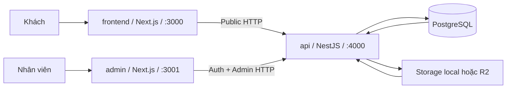
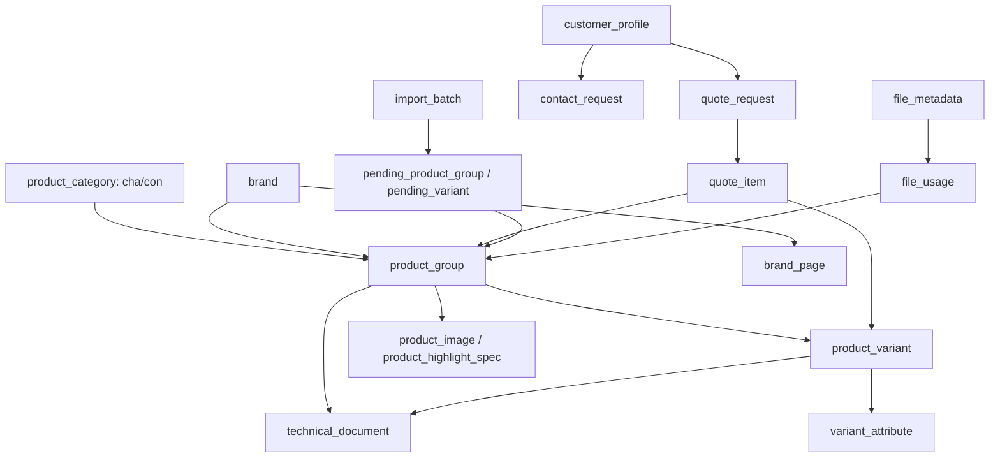
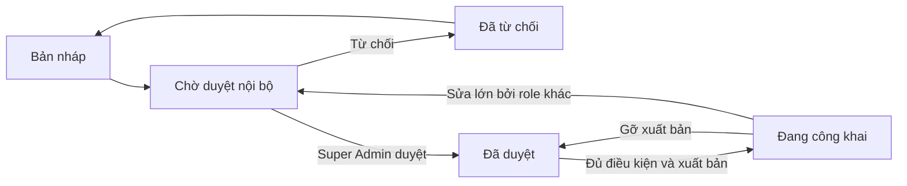

# Tổng quan chi tiết project Web Song Thanh

**Ngày đối chiếu:** 26/10/2026 (giờ Việt Nam).

**Phạm vi:** source trong checkout ở thời điểm đối chiếu, trước khi đóng gói commit.
**Trạng thái:** tài liệu giải thích hệ thống hiện có để chuẩn bị LVTN; các quy tắc nghiệp vụ chỉ trở thành đặc tả chính thức sau khi người dùng xác nhận.

Đọc file này để hiểu **hệ thống gồm những phần nào, mỗi phần làm gì và dữ liệu đi qua đâu**. Đọc [AUDIT.md](AUDIT.md) để xem số liệu kiểm kê, kết quả kiểm thử, rủi ro và giới hạn; [docs/workflowAnalysis.md](docs/workflowAnalysis.md) là bản thảo 29 workflow từng bước, [docs/workflowEvidence.md](docs/workflowEvidence.md) là danh sách link source của bản thảo đó. Không dùng tài liệu đã bị xóa trong lịch sử Git làm yêu cầu.

## 1. Hệ thống giải quyết việc gì?

Website công khai giúp khách tìm hiểu Song Thanh, xem sản phẩm và biến thể, thương hiệu, dịch vụ, dự án, tin tức, rồi gửi liên hệ hoặc yêu cầu tư vấn/báo giá. Website quản trị giúp nhân viên cập nhật dữ liệu và nội dung, duyệt/xuất bản một số đối tượng, theo dõi yêu cầu, nhập bảng tính, quản lý tệp và phân quyền. Backend kiểm tra dữ liệu, thực hiện quy tắc nghiệp vụ và truy cập PostgreSQL/kho tệp.

**Ranh giới hiện tại:** yêu cầu báo giá là một yêu cầu khách gửi để nhân viên xử lý; code không có giỏ hàng, đơn hàng, thanh toán hoặc sinh báo giá thương mại chính thức. Không có portal/tài khoản cho khách công khai. Những ý tưởng trong kế hoạch thiết kế hoặc file đề xuất chưa chạy không được tính là tính năng đã bàn giao.

### Tác nhân và kết quả chính

| Tác nhân | Mục tiêu | Kết quả hệ thống có thể tạo |
| --- | --- | --- |
| Khách truy cập | Tìm thông tin, chọn sản phẩm/biến thể, liên hệ | Trang công khai được lọc, `contact_request` hoặc `quote_request`. |
| Nhân viên nội dung | Cập nhật trang, thương hiệu, dịch vụ, dự án, banner/menu | Bản nháp hoặc bản công khai tùy quyền, trạng thái và điều kiện từng module. |
| Nhân viên sản phẩm | Quản lý danh mục, sản phẩm, biến thể, thông số, tài liệu; nhập bảng tính | Dữ liệu sản phẩm chính thức, lô nhập có truy vết; không tự công khai sau import. |
| Nhân viên xử lý yêu cầu | Xem, phân công, ghi chú, phân loại liên hệ/báo giá | Trạng thái xử lý và người phụ trách của từng yêu cầu. |
| Super Admin | Quản lý người dùng/vai trò; duyệt/từ chối/xuất bản nội dung | Quyền hiệu lực, quyết định duyệt và hiển thị. |

Tên các vai trò được seed là `super_admin`, `content_admin`, `product_admin`, `sales_admin`, `viewer`; hệ thống cho tạo vai trò khác. Quyền thực tế phải đọc từ role và controller, không suy ra toàn bộ từ tên vai trò ([seed](api/seeds/202604250001_admin_auth_seed.js), [PermissionGuard](api/src/common/permissions/permission.guard.ts)).

## 2. Kiến trúc và đường đi của một request

| Bước | Website công khai | Website quản trị |
| --- | --- | --- |
| Route/UI | `frontend/src/app` chọn trang; `features/` hiển thị dữ liệu, form. | `admin/src/app` chọn trang; `features/` chứa workspace, danh sách, chi tiết, editor. |
| Client HTTP | Route/component gọi API công khai hoặc `proxy.ts` xử lý chuyển hướng. | `admin/src/lib/api-client.ts` gọi API; auth state và permission policy quyết định màn/hành động hiển thị. |
| Controller | `/public/*`, `/public/home-page`, health. | `/auth/*`, `/song-thanh/*`, một route gợi ý thuộc tính `/admin/*`. |
| Service | Chuẩn hóa đầu vào, kiểm tra quy tắc, ghép read model/ghi dữ liệu. | Kiểm điều kiện sửa, xung đột phiên, workflow duyệt, quyền của người thực hiện. |
| Repository | Knex đọc dữ liệu đã được phép công khai và tạo yêu cầu khách. | Knex truy cập bản ghi nội bộ, quan hệ, giao dịch và audit. |

API khởi tạo ở [main.ts](api/src/main.ts), đăng ký module ở [app.module.ts](api/src/app.module.ts); validation, error filter, response interceptor, CORS, security header và throttling nằm ở đây/các controller. PostgreSQL dùng Knex ([KnexService](api/src/db/knex.service.ts)); migration thật nằm trong [api/migrations](api/migrations/), còn [database/ddl](database/ddl/) là snapshot. Storage local/R2 được chọn bằng môi trường, không phải hai kho luôn chạy song song.

### Các cấu hình cần biết khi chạy

| Ứng dụng | Lệnh ở package | Cổng mặc định | Cấu hình liên quan |
| --- | --- | ---: | --- |
| `api/` | `npm.cmd run dev`, `typecheck`, `test:unit`, `build`, `migrate:latest` | 4000 | Database, JWT, CORS, proxy tin cậy, local/R2 storage trong `api/.env`; mẫu là [.env.example](.env.example). |
| `admin/` | `npm.cmd run dev`, `typecheck`, `build` | 3001 | URL API trình duyệt, CSP/preview origin, auth state. |
| `frontend/` | `npm.cmd run dev`, `typecheck`, `test`, `build` | 3000 | URL API, public site URL, redirect proxy và Next image config. |

Không đưa `api/.env`, tệp storage, database dump hoặc `songthanh-media.tar` vào Git. File `.gitignore` hiện loại trừ các đường này. `seed:run` chỉ dùng cho database mới đã đặt mật khẩu Admin riêng; đọc [README](README.md), [API README](api/README.md) và [dev scripts README](scripts/dev/README.md) trước khi chạy.

## 3. Bản đồ mã nguồn theo trách nhiệm

| Vị trí | Nội dung cần tìm | Khi nào đọc |
| --- | --- | --- |
| [frontend/src/app](frontend/src/app/) | `page.tsx` xác định route công khai, `layout.tsx`, `error.tsx`, `sitemap.ts`, `robots.ts`, route preview. | Xác định URL và cách trang ghép dữ liệu. |
| [frontend/src/features](frontend/src/features/) | Product listing/detail/search, brand, home, news, contact/quote form và các section. | Tìm tương tác cụ thể của khách. |
| [frontend/src/components](frontend/src/components/) | Site shell/header/footer và component tái sử dụng. | Kiểm tra menu, điều hướng, phần dùng chung. |
| [admin/src/app](admin/src/app/) | 47 route Admin gồm login, dashboard, danh sách/chi tiết. | Xác định màn quản trị nào có thật. |
| [admin/src/features](admin/src/features/) | Workspace nghiệp vụ và editor; nhiều màn dùng chung component. | Kiểm tra chức năng/sự kiện trên màn Admin. |
| [admin/src/lib](admin/src/lib/) | API client, quyền, xuất file và helper. | Kiểm tra request, quyền ở UI, xử lý export. |
| [api/src/common](api/src/common/) | Auth, permission, workflow guard, validation, security, audit, lỗi, response. | Kiểm tra các ranh giới xuyên module. |
| [api/src/modules](api/src/modules/) | Mỗi domain có controller/service/repository/types/DTO khi cần. | Tìm luật nghiệp vụ và API thật. |
| [api/migrations](api/migrations/), [api/seeds](api/seeds/) | Schema thay đổi và dữ liệu nền. | Vẽ ERD, kiểm ràng buộc và trạng thái khởi tạo. |
| [scripts/qa](scripts/qa/), [api/tests](api/tests/), [admin/tests](admin/tests/), [frontend/tests](frontend/tests/) | Unit, smoke, Playwright, kiểm dữ liệu và inventory. | Phân biệt test đã chạy với test chỉ tồn tại trong source. |

Kiểm kê source ngày 26/10 ghi nhận 243 file TypeScript ở `api/src`, 184 file TS/TSX ở `admin/src`, 157 file TS/TSX ở `frontend/src`; 221 endpoint API, 47 route Admin, 19 route Frontend, 118 mã quyền, 48 migration và 62 bảng. Đây là **số file/route/schema**, không phải số workflow đã kiểm thử xong. Cách tạo lại số liệu: [generate-system-inventory.mjs](scripts/qa/generate-system-inventory.mjs).

## 4. Toàn bộ route giao diện

### 4.1 Website công khai: 19 route `page.tsx`

| Route | Mục đích | Dữ liệu/API liên quan |
| --- | --- | --- |
| `/` | Trang chủ, các section được quản trị, CTA liên hệ/tư vấn. | Site shell, home layout, banner, nội dung/trích dữ liệu từ các module. |
| `/san-pham` | Cửa vào catalogue, danh mục cấp trên. | Public categories, nhóm sản phẩm, brand. |
| `/san-pham/danh-sach` | Danh sách với tìm kiếm, bộ lọc, sắp xếp, phân trang. | Public product groups/search suggestions/facets. |
| `/san-pham/[slug]` | Chi tiết nhóm sản phẩm, biến thể, thông số, ảnh, tài liệu, báo giá. | Public product group detail, variant/public file. |
| `/tim-kiem` | Tìm trên website. | Public search suggestions và kết quả nội dung/sản phẩm hiện có. |
| `/doi-tac-thuong-hieu`, `/doi-tac-thuong-hieu/[slug]` | Danh sách brand và trang biên tập riêng cho brand. | Public brands, brand page, banner và sản phẩm nổi bật. |
| `/dich-vu`, `/dich-vu/[slug]` | Danh sách/chi tiết dịch vụ và CTA. | Public services, nội dung trang, sản phẩm liên quan. |
| `/du-an`, `/du-an/[slug]` | Danh sách/chi tiết dự án, ảnh gallery, sản phẩm liên quan. | Public projects, project gallery. |
| `/tin-tuc`, `/tin-tuc/[slug]` | Tin tức, chuyên mục và bài liên quan. | Public news, news categories, page content. |
| `/gioi-thieu`, `/ho-so-nang-luc`, `/[slug]` | Trang thông tin cố định/động. | Public page content, banner và site settings khi cần. |
| `/lien-he` | Thông tin công ty và form liên hệ. | Site settings, page content, `POST /public/contact-requests`. |
| `/admin-preview/brand-page`, `/admin-preview/page-content` | Preview nội dung chưa công bố từ Admin. | Cơ chế preview của editor; không phải hành trình công khai thông thường. |

Các route động trả dữ liệu theo slug; route tồn tại không bảo đảm mọi slug đều hợp lệ. Tài nguyên `favicon`, `robots` và `sitemap` là route/metadata kỹ thuật, không được tính vào 19 `page.tsx` ([frontend/src/app](frontend/src/app/)). `frontend/src/proxy.ts` hỗ trợ redirect động từ API.

### 4.2 Admin: 47 route `page.tsx`

| Khu vực | Route có thật | Chức năng chính |
| --- | --- | --- |
| Truy cập | `/`, `/login`, `/access-denied` | Điều hướng vào dashboard, đăng nhập, báo thiếu quyền. |
| Tổng quan/nhật ký | `/dashboard`, `/audit-logs`, `/audit-logs/[id]` | Số liệu hoạt động, danh sách và chi tiết audit. |
| Tài khoản/quyền | `/users`, `/roles` | Người dùng Admin, vai trò và ma trận quyền. |
| Cấu hình website | `/website-settings`, `/home-page` | Thông tin công ty, social/nhận diện; section trang chủ. |
| Menu/banner/redirect | `/menu`, `/menu/[id]`, `/banners`, `/banners/[id]`, `/redirects`, `/redirects/[id]` | Điều hướng, vị trí hiển thị và URL cũ. |
| Nội dung/tệp | `/page-contents`, `/page-contents/[id]`, `/page-contents/brand-pages`, `/page-contents/brand-pages/[id]`, `/files` | Trang/tin, trang brand, thư viện file. |
| Danh mục/brand | `/product-categories`, `/product-categories/main`, `/product-categories/sub`, `/product-categories/[id]`, `/brands`, `/brands/[id]` | Cây phân loại và thương hiệu cơ sở. |
| Sản phẩm | `/product-groups`, `/product-groups/[id]`, `/product-variants`, `/product-variants/[id]`, `/technical-documents`, `/technical-documents/[id]` | Hồ sơ nhóm, cấu hình bán được, tài liệu. |
| Nhập/xuất | `/import`, `/import/new`, `/import/[id]` | Lô nhập Excel/CSV, review/áp dụng; xuất dữ liệu sản phẩm. |
| Yêu cầu/khách | `/contacts`, `/contacts/[id]`, `/quotes`, `/quotes/[id]`, `/customers`, `/customers/new`, `/customers/[id]` | Hộp thư, phân công, ghi chú, hồ sơ khách và xuất dữ liệu khách. |
| Nội dung cấu trúc | `/services`, `/services/[id]`, `/projects`, `/projects/[id]` | Dịch vụ, dự án, gallery và quan hệ sản phẩm. |

Các route trên là điểm vào giao diện; một số trang danh sách/editor có nhiều tab/thao tác và một số thao tác con không có route riêng. Quyền vào route được đối chiếu trong [ProtectedRoute](admin/src/features/auth/ProtectedRoute.tsx) và [permissions.ts](admin/src/lib/permissions.ts), nhưng API vẫn là lớp kiểm quyền cuối.

## 5. Toàn bộ module API đang đăng ký

Module được import ở [app.module.ts](api/src/app.module.ts). Số endpoint là kết quả quét decorator controller, gồm read, write và thao tác con; ví dụ `project` có endpoint gallery và quan hệ sản phẩm. `admin-permission` là provider/module không có controller route riêng.

| Module | Prefix chính | Endpoint | Trách nhiệm |
| --- | --- | ---: | --- |
| `public` | `/public` | 23 | Site shell, dữ liệu công khai, form, view, public file. |
| `home-page` | `/public/home-page`, `/song-thanh/home-page` | 3 | Cấu hình section trang chủ. |
| `auth` | `/auth` | 5 | Login/logout/refresh/me/change-password. |
| `admin-user` | `/song-thanh/admin-users` | 6 | Tài khoản Admin và mật khẩu/trạng thái. |
| `admin-role` | `/song-thanh/admin-roles` | 6 | Vai trò và permission. |
| `product-category` | `/song-thanh/product-categories` | 6 | Danh mục 2 cấp. |
| `brand` | `/song-thanh/brands` | 6 | Thương hiệu cơ sở. |
| `brand-page` | `/song-thanh/brand-pages` | 6 | Nội dung trang chi tiết thương hiệu. |
| `product-group` | `/song-thanh/product-groups` | 15 | Hồ sơ nhóm sản phẩm, ảnh/thông số/thao tác hàng loạt. |
| `product-variant` | `/song-thanh/product-variants`, `/admin/variant-attributes` | 12 | SKU/model, giá, thuộc tính và gợi ý thuộc tính. |
| `technical-document` | `/song-thanh/technical-documents` | 6 | Tài liệu gắn nhóm/biến thể. |
| `import-workspace` | `/song-thanh/import-batches`, `/song-thanh/import-conflicts` | 22 | Tiếp nhận, mapping, staging, conflict, apply. |
| `contact`, `quote`, `customer` | `/song-thanh/contacts`, `/song-thanh/quotes`, `/song-thanh/customers` | 8 + 8 + 7 | Yêu cầu khách và hồ sơ. |
| `page-content`, `news-category` | `/song-thanh/page-contents`, `/song-thanh/news-categories` | 6 + 6 | Trang/tin và chuyên mục. |
| `service`, `project` | `/song-thanh/services`, `/song-thanh/projects` | 9 + 15 | Nội dung cấu trúc và quan hệ sản phẩm/gallery. |
| `banner`, `menu`, `website-settings` | `/song-thanh/banners`, `/song-thanh/menus`, `/song-thanh/menu-items`, `/song-thanh/website-settings` | 6 + 11 + 7 | Vị trí ảnh/CTA, điều hướng, thông tin công ty. |
| `redirect`, `file` | `/song-thanh/redirects`, `/song-thanh/files`, `/song-thanh/file-usages` | 6 + 11 | URL cũ và thư viện tệp. |
| `dashboard`, `audit-log`, `health` | `/song-thanh/dashboard`, `/song-thanh/audit-logs`, `/health` | 1 + 2 + 2 | Tổng quan, nhật ký, sức khỏe ứng dụng. |
| **Tổng** | | **221** | 27 nhóm có controller. |

Không tự tạo endpoint hoặc quyền mới từ bảng này. Danh mục method/path đầy đủ, cùng permission decorator từng method, có thể sinh lại vào `tmp/qa-artifacts/generated/system-inventory.json` bằng script đã nêu. Route Admin dùng prefix `/song-thanh/*` không nên bị nhầm với website công khai mang tên Song Thanh.

## 6. Dữ liệu: đối tượng, quan hệ và trạng thái

### 6.1 Các quan hệ cần hiểu trước khi viết ERD

Sơ đồ chỉ nhấn quan hệ cần cho các hành trình chính; cardinality/FK/ON DELETE chính xác phải lấy từ migration và DB đang chạy. `quote_item` lưu cả thông tin/snapshot để lịch sử yêu cầu không bị diễn giải lại hoàn toàn theo sản phẩm đã đổi. `brand` là bản ghi phân loại, `brand_page` là nội dung kể câu chuyện của brand; `page_content` là trang/tin nói chung, không thay thế bản ghi `service`/`project`.

### 6.2 Kiểm kê 62 bảng theo phạm vi

| Nhóm | Bảng | Ý nghĩa cần phân biệt |
| --- | --- | --- |
| Admin và quyền (6) | `admin_permission`, `admin_refresh_session`, `admin_role`, `admin_role_permission`, `admin_user`, `admin_user_role` | Một tài khoản có một role active theo migration hiện tại; quyền là quan hệ role–permission. |
| Website/nội dung (20) | `banner`, `brand`, `brand_page`, `brand_page_featured_product_group`, `brand_page_source`, `brand_page_stat`, `company_info`, `company_social_link`, `home_section`, `menu`, `menu_item`, `news_category`, `page_content`, `project`, `project_gallery`, `project_product_group`, `redirect_rule`, `service`, `service_product_group`, `site_daily_view` | Nhiều nguồn ghép ra một trang; banner/menu/section có trạng thái riêng. |
| Sản phẩm (14) | `product_category`, `product_group`, `product_group_daily_view`, `product_group_tag`, `product_highlight_spec`, `product_image`, `product_spec`, `product_variant`, `spec_group`, `tag`, `technical_document`, `variant_attribute`, `variant_spec`, `variant_spec_group` | Bảng cũ/chưa có controller riêng không tự trở thành workflow Admin. |
| Khách hàng/yêu cầu (6) | `contact_internal_note`, `contact_request`, `customer_profile`, `quote_internal_note`, `quote_item`, `quote_request` | Trạng thái xử lý yêu cầu khác trạng thái xuất bản nội dung. |
| Import (9) | `conflict_resolution`, `data_conflict`, `import_batch`, `import_error_log`, `import_mapping`, `import_mapping_profile`, `pending_product_group`, `pending_variant`, `raw_data` | Staging và quyết định import tách khỏi hồ sơ sản phẩm chính thức. |
| Tệp/audit (3) | `file_metadata`, `file_usage`, `audit_log` | Metadata/tệp vật lý/nơi dùng là các lớp khác nhau. |
| Có trong schema nhưng chưa là luồng quản trị độc lập (2) | `certificate`, `partner` | Không suy ra feature từ tên bảng. |
| Metadata migration (2) | `knex_migrations`, `knex_migrations_lock` | Cơ chế Knex, không phải dữ liệu nghiệp vụ. |

Kiểm tra database local ngày 26/10 cho thấy 62 bảng, 48 migration áp dụng, 85 FK không có bản ghi mồ côi và 13/13 phép kiểm tra toàn vẹn đạt ([database-integrity-audit.mjs](scripts/qa/database-integrity-audit.mjs)). File [schema snapshot](database/ddl/song_thanh_deployment_schema_20260730.sql) chụp tại 30/07/2026; các migration sau đó vẫn cần áp dụng, nhất là trước khi so schema môi trường bàn giao.

### 6.3 Bốn trục trạng thái không được gộp

| Trục | Ví dụ | Tác động |
| --- | --- | --- |
| `review_status` | `draft`, `pending_review`, `approved`, `rejected` | Quyết định duyệt nội bộ cho product group/variant và nội dung có workflow. |
| `publish_status` | `unpublished`, `published`, `archived` | Quyết định công bố bản ghi thuộc loại có publish; public API còn lọc cha/quan hệ. |
| `status` | `active`, `inactive` | Khả dụng vận hành của danh mục/brand/product/variant/banner và loại tương ứng. |
| `deleted_at` | `NULL` hoặc timestamp | Lưu trữ mềm và khả năng khôi phục; không đồng nghĩa với ba trục trên. |

`contact_request`/`quote_request` dùng `new → in_progress/done/spam/invalid` cho xử lý. Import dùng trạng thái lô `created/validated/in_review/ready_to_apply/applied/cancelled`, còn dòng tạm dùng `pending_review/approved/rejected/applied`. Public filter cụ thể xem [public.repository.ts](api/src/modules/public/public.repository.ts); giá trị import ở [import-workspace.types.ts](api/src/modules/import-workspace/import-workspace.types.ts).

## 7. Danh mục chức năng từ màn hình đến dữ liệu

Mỗi mục dưới đây nối **màn giao diện → API → bảng/điều kiện → kết quả**, để có thể chọn làm use case, activity/sequence diagram và ca kiểm thử. Đây là hành vi đọc từ code; không bổ sung cam kết nghiệp vụ ngoài hệ thống.

### 7.1 Trang chủ, site shell và điều hướng

- **Khách:** mở `/`; header/footer nạp thông tin công ty và menu; các section trang chủ lấy cấu hình bật/tắt, thứ tự và dữ liệu tham chiếu. CTA dẫn sang trang/biểu mẫu hiện có.
- **Admin:** `/home-page` quyết định 9 loại section; `/website-settings` sửa company info/social/logo/favicon; `/menu` quản lý cây mục và vị trí; `/banners` đặt ảnh/CTA theo vị trí. Một section bật nhưng bản ghi sản phẩm/dịch vụ/dự án nguồn chưa công khai có thể không có nội dung để hiển thị.
- **Dữ liệu/API:** `home_section`, `company_info`, `company_social_link`, `menu`, `menu_item`, `banner`; `GET /public/site-shell`, `GET /public/home-page`, `GET /public/banners`. Menu active có thể bỏ liên kết tới trang hệ thống chưa public. Nguồn: [HomePageService](api/src/modules/home-page/home-page.service.ts), [PublicService](api/src/modules/public/public.service.ts), [SiteHeader](frontend/src/components/layout/SiteHeader.tsx).

### 7.2 Tìm kiếm, danh mục, nhóm sản phẩm và biến thể

- **Khách:** chọn danh mục ở `/san-pham`, dùng bộ lọc/từ khóa/sắp xếp ở `/san-pham/danh-sach`, mở `/san-pham/[slug]`, chọn cấu hình/biến thể, xem giá nếu công khai hoặc nút hỏi giá. Search suggestion là endpoint riêng.
- **Admin:** `/product-categories` quản lý cây 2 cấp; `/brands` quản lý brand cơ sở; `/product-groups` chứa tên, slug, danh mục, brand, mô tả, ảnh chính, SEO, thứ tự, trạng thái duyệt/hiển thị; `/product-variants` chứa SKU/model, thuộc tính, chế độ giá và ảnh. Có thao tác trạng thái hàng loạt với xem trước ở module tương ứng.
- **Dữ liệu/API:** `product_category`, `brand`, `product_group`, `product_variant`, `variant_attribute`, `product_image`, `product_highlight_spec`. Public API lọc nhóm `active + approved + published + deleted_at NULL`, danh mục/brand hợp lệ; biến thể được lọc riêng. Giá là dữ liệu biến thể, không phải giá cố định của nhóm. Nguồn: [product-group.service.ts](api/src/modules/product-group/product-group.service.ts), [product-variant.service.ts](api/src/modules/product-variant/product-variant.service.ts), [public.repository.ts](api/src/modules/public/public.repository.ts).
- **Điểm cần nhớ:** sản phẩm cha public không tự làm biến thể public; thiếu biến thể/gallery/SEO có thể là cảnh báo chất lượng nhưng không phải mọi cảnh báo đều chặn công bố. Tạo/cập nhật ảnh hoặc thuộc tính có thể tác động vòng duyệt của cha.

### 7.3 Ảnh sản phẩm, thông số và tài liệu kỹ thuật

- **Admin:** gắn ảnh gallery/thứ tự/alt text, thông số nổi bật, thuộc tính của biến thể; tạo tài liệu gắn nhóm hoặc biến thể và đặt `status`, `is_public`.
- **Khách:** chỉ xem ảnh/thông số/tài liệu qua sản phẩm đủ điều kiện công khai; tài liệu gắn biến thể chỉ hiện khi biến thể được phép public. Ảnh sản phẩm đi qua đường cấp có watermark; tệp thư viện khác không tự có quyền public.
- **Dữ liệu/API:** `product_image`, `product_highlight_spec`, `variant_attribute`, `technical_document`, `file_metadata`, `file_usage`; nguồn [technical-document.service.ts](api/src/modules/technical-document/technical-document.service.ts), [public-product-file.repository.ts](api/src/modules/public/public-product-file.repository.ts), [publicFileAccess.test.ts](api/tests/unit/publicFileAccess.test.ts).

### 7.4 Thương hiệu và trang thương hiệu

- **Admin:** `/brands` tạo/sửa brand dùng để phân loại sản phẩm; `/page-contents/brand-pages` soạn trang chi tiết, ảnh hero, nội dung, nguồn, số liệu và sản phẩm nổi bật. Đây là hai hồ sơ khác nhau. Số liệu cần `active` và `is_verified` để vào public read model.
- **Khách:** danh sách brand có thể hiện brand active dù brand chưa có trang chi tiết; `/doi-tac-thuong-hieu/[slug]` cần trang brand được duyệt/xuất bản và brand active. Sản phẩm nổi bật còn phải thuộc brand và được phép công khai.
- **Dữ liệu/API:** `brand`, `brand_page`, `brand_page_source`, `brand_page_stat`, `brand_page_featured_product_group`; nguồn [brand-page.service.ts](api/src/modules/brand-page/brand-page.service.ts), [public.repository.ts](api/src/modules/public/public.repository.ts).

### 7.5 Dịch vụ và dự án

- **Admin:** `/services` soạn nội dung dịch vụ và quan hệ sản phẩm; `/projects` soạn dự án, địa điểm/năm/nội dung, gallery có thứ tự và sản phẩm liên quan. Nội dung qua lưu, xem trước, gửi duyệt, duyệt và xuất bản.
- **Khách:** `/dich-vu*` và `/du-an*` chỉ lấy bản chính đủ điều kiện; sản phẩm liên quan được lọc public riêng. CTA dịch vụ có thể chuyển tới form tư vấn/liên hệ. Không suy ra dự án sử dụng sản phẩm nào ngoài liên kết đã lưu.
- **Dữ liệu/API:** `service`, `service_product_group`, `project`, `project_gallery`, `project_product_group`; nguồn [service.service.ts](api/src/modules/service/service.service.ts), [project.service.ts](api/src/modules/project/project.service.ts), [public.service.ts](api/src/modules/public/public.service.ts).

### 7.6 Trang thông tin, tin tức và chuyên mục

- **Admin:** `/page-contents` lưu loại `page`/`news`, slug, tiêu đề, thân bài/khối cấu trúc, ảnh/SEO; tin có chuyên mục, ngày đăng, nổi bật. Có preview trước xuất bản. `/news-categories` không có route độc lập trong Admin App Router nhưng API/màn nội dung quản lý chuyên mục.
- **Khách:** `/tin-tuc*`, `/gioi-thieu`, `/ho-so-nang-luc`, `/<slug>` lấy phần biên tập public; tin có chuyên mục và bài liên quan. Nội dung HTML được xử lý trước khi cấp/hiển thị.
- **Ranh giới:** bản ghi Page Content của một trang hệ thống chỉ quản lý **phần biên tập**. Ví dụ thay `publish_status` của phần biên tập `/san-pham` không tự tắt route catalogue, danh mục hay banner từ module khác. Nguồn: [page-content.service.ts](api/src/modules/page-content/page-content.service.ts), [public.repository.ts](api/src/modules/public/public.repository.ts), [publicRouteVisibility.test.mjs](frontend/tests/publicRouteVisibility.test.mjs).

### 7.7 Banner, menu, thông tin công ty và redirect

- **Admin:** banner có vị trí, ảnh desktop/mobile, thứ tự, CTA và trạng thái active/inactive; menu có vị trí, mục cha/con và đích; website settings có company info/social/logo/favicon; redirect gắn nguồn/đích nội bộ với 301/302.
- **Khách:** các phần active và chưa lưu trữ được lấy theo vị trí/URL. `frontend/src/proxy.ts` áp redirect động khi có cấu hình; URL không khớp thì request đi tiếp. Banner **không có** `review_status/publish_status` trong runtime.
- **Dữ liệu/API:** `banner`, `menu`, `menu_item`, `company_info`, `company_social_link`, `redirect_rule`; nguồn [banner.service.ts](api/src/modules/banner/banner.service.ts), [menu.service.ts](api/src/modules/menu/menu.service.ts), [redirect.service.ts](api/src/modules/redirect/redirect.service.ts).

### 7.8 Thư viện tệp

- **Admin:** `/files` upload hoặc tạo metadata, xem trước/tải về, tra nơi dùng, lưu trữ/khôi phục. Endpoint upload giới hạn file 25 MB ở controller và kiểm kiểu/nội dung ở tầng xử lý; tệp đang được sử dụng có ràng buộc khi lưu trữ.
- **Khách:** chỉ nhận tệp qua cổng `GET /public/files/:id` hoặc đường tải ảnh sản phẩm watermark khi liên kết public hợp lệ. `file_metadata`, tệp vật lý và `file_usage` phải được phân biệt khi điều tra lỗi ảnh/tài liệu.
- **Cấu hình:** `FILE_STORAGE_DRIVER=local` hoặc `r2`; R2 cần thông tin riêng trong `.env`. Nguồn: [file.controller.ts](api/src/modules/file/file.controller.ts), [file.service.ts](api/src/modules/file/file.service.ts), [public.controller.ts](api/src/modules/public/public.controller.ts).

### 7.9 Form liên hệ và hộp thư liên hệ

- **Khách:** form liên hệ cần tên, số điện thoại, lời nhắn; email và công ty tùy chọn. `POST /public/contact-requests` kiểm DTO, giới hạn tần suất, ghi yêu cầu `new` và liên kết/tạo `customer_profile`.
- **Admin:** `/contacts` lọc theo từ khóa, trạng thái, ngày, người phụ trách, phạm vi lưu trữ; chi tiết có nguồn, thông tin khách và ghi chú. Quyền đọc, đổi trạng thái, phân công, ghi chú, lưu trữ/khôi phục tách riêng. Worktree hiện tại kiểm người nhận phân công phải active và có quyền `contact.read` + `contact.update_status`.
- **Dữ liệu/API:** `contact_request`, `contact_internal_note`, `customer_profile`; nguồn [public.dto.ts](api/src/modules/public/public.dto.ts), [contact.service.ts](api/src/modules/contact/contact.service.ts), [logic-user-reference.repository.ts](api/src/common/users/logic-user-reference.repository.ts).

### 7.10 Yêu cầu tư vấn/báo giá và hộp thư báo giá

- **Khách:** form có thể chỉ mô tả nhu cầu chung hoặc chứa tối đa 50 dòng sản phẩm/biến thể, số lượng và tối đa 20 yêu cầu dự án cấu trúc. DTO yêu cầu tên, số điện thoại 10 chữ số bắt đầu bằng 0 và email. API kiểm tra lại nhóm/biến thể còn public ở lúc lưu; ghi trạng thái `new`, snapshot giá công khai của biến thể nếu có. Giá snapshot là bối cảnh yêu cầu, không phải cam kết bán hàng.
- **Admin:** `/quotes` lọc và mở chi tiết để xem dòng hàng, số lượng, ghi chú, bối cảnh dự án, người phụ trách; đổi `new/in_progress/done/spam/invalid`, lưu trữ/khôi phục. Worktree hiện tại chỉ cho phân công người active có cả `quote.read` và `quote.update_status`.
- **Dữ liệu/API:** `quote_request`, `quote_item`, `quote_internal_note`, `customer_profile`; nguồn [publicQuote.ts](api/src/modules/public/publicQuote.ts), [quote.service.ts](api/src/modules/quote/quote.service.ts), [quote.repository.ts](api/src/modules/quote/quote.repository.ts), [quotePriceSnapshot migration](api/migrations/202610090002_quotePriceSnapshot.js).

### 7.11 Hồ sơ khách hàng

- **Admin:** `/customers` tạo/sửa, tìm/lọc, xem chi tiết và lịch sử liên hệ/báo giá, lưu trữ/khôi phục; có nút xuất dữ liệu. Khách không có quyền xem hồ sơ này qua website.
- **Dữ liệu:** `customer_profile` có thể được tạo/liên kết khi gửi form; việc gom hồ sơ theo thông tin nhận diện nằm ở repository. Xóa vĩnh viễn là thao tác đặc biệt có ràng buộc, không phải cách dọn mặc định. Nguồn [customer.service.ts](api/src/modules/customer/customer.service.ts), [customer.repository.ts](api/src/modules/customer/customer.repository.ts), [public.repository.ts](api/src/modules/public/public.repository.ts).

### 7.12 Nhập Excel/CSV và quản lý lô

- **Intake:** ở `/import/new`, người có quyền tải `.xlsx/.csv` (tối đa 20 MB), chọn sheet/dòng, xem mẫu/header, ánh xạ cột hoặc dùng profile. Bước này tạo `import_batch`/`raw_data`, chưa tạo sản phẩm chính thức.
- **Staging/review:** hệ thống chuẩn hóa nhóm/biến thể tạm; nhân viên sửa/duyệt/bỏ dòng, giải quyết xung đột, xem readiness và apply preview. Trạng thái dòng import `approved` không phải `review_status=approved` của sản phẩm.
- **Apply:** transaction tạo/cập nhật nhóm, biến thể và thuộc tính, ghi mapping; bản **tạo mới** `active + approved + unpublished`, cần workflow xuất bản riêng. Lô đã áp dụng không được xóa workspace vĩnh viễn. Ảnh nhúng trong XLSX hiện chỉ được đếm/cảnh báo, chưa gắn vào sản phẩm.
- **Dữ liệu/API:** các bảng import ở mục 6.2, [import-workspace.controller.ts](api/src/modules/import-workspace/import-workspace.controller.ts), [import-workspace.service.ts](api/src/modules/import-workspace/import-workspace.service.ts), [import-workspace.types.ts](api/src/modules/import-workspace/import-workspace.types.ts).

### 7.13 Xuất dữ liệu

- **Admin:** các màn Import và Customers tải dữ liệu qua endpoint đọc đã có rồi tạo bảng tính phía trình duyệt; không có API export riêng. Có bộ lọc khoảng ngày/phạm vi dữ liệu và giới hạn số trang; nếu vượt giới hạn hoặc thiếu trang, code từ chối xuất thay vì tạo file thiếu âm thầm.
- **Giới hạn:** tùy chọn mang tên “public-safe” dùng cờ lọc của endpoint quản trị, không đồng nghĩa mọi dòng/tệp trong file đã được xác nhận phát hành công khai. Phải rà trước khi chia sẻ. Nguồn [ImportWorkspacePage.tsx](admin/src/features/import-workspace/ImportWorkspacePage.tsx), [exportPagination.ts](admin/src/features/import-workspace/exportPagination.ts), [exportFile.ts](admin/src/lib/exportFile.ts).

### 7.14 Đăng nhập, vai trò, quyền và phiên

- **Admin:** `/login` gọi `POST /auth/login`; refresh/logout/change-password/me là endpoint riêng. Tài khoản phải active, chưa lưu trữ, có đúng một role active. Quyền hiệu lực được kiểm tra ở request tiếp theo; khóa tài khoản hoặc đổi quyền role tác động phiên hiện có theo service/guard.
- **Super Admin:** tạo/sửa user, role, permission, đặt lại mật khẩu, khóa user; controller gắn `@SuperAdminOnly()` cho mutation user/role. `WorkflowApprovalGuard` siết chuyển `approved/rejected/published` cho các loại có duyệt.
- **Dữ liệu/API:** `admin_user`, `admin_role`, `admin_permission`, bảng nối và refresh session; nguồn [AuthGuard](api/src/common/auth/auth.guard.ts), [PermissionGuard](api/src/common/permissions/permission.guard.ts), [WorkflowApprovalGuard](api/src/common/workflow/workflow-approval.guard.ts), [auth.service.ts](api/src/modules/auth/auth.service.ts).

### 7.15 Dashboard, lượt xem và audit log

- **Khách:** một số lần mở website/trang sản phẩm có thể ghi lượt xem qua public endpoint; không đồng nghĩa mọi lượt đã quan tâm mua hàng.
- **Admin:** `/dashboard` xem số liệu/tổng hợp; `/audit-logs` lọc/mở dấu vết thao tác. Quyền xem dashboard và audit log là quyền riêng; API audit log là read-only.
- **Dữ liệu/API:** `site_daily_view`, `product_group_daily_view`, `audit_log`; nguồn [dashboard.service.ts](api/src/modules/dashboard/dashboard.service.ts), [audit-log.service.ts](api/src/modules/audit-log/audit-log.service.ts), [audit-trail.interceptor.ts](api/src/common/audit/audit-trail.interceptor.ts).

## 8. Các workflow xuyên lớp quan trọng

Để tránh đếm trùng CRUD, bản thảo chi tiết trong [workflowAnalysis.md](docs/workflowAnalysis.md) chia thành 29 workflow: **WF01–04** đọc website/tệp; **WF05–09** gửi và xử lý yêu cầu khách; **WF10–16** dữ liệu sản phẩm/import; **WF17–25** biên tập và vận hành website; **WF26–28** truy cập/theo dõi; **WF29** xuất dữ liệu. Các luồng dưới đây cho thấy request đi từ UI tới dữ liệu ra sao. Khi đưa vào luận văn, chỉ chọn use case sau khi xác nhận phạm vi với người dùng/giảng viên.

### 8.1 Biên tập, duyệt và xuất bản

1. Người có quyền `*.create`/`*.update` tạo hoặc chỉnh một nội dung thuộc product group, variant, page, brand page, service hoặc project. Service kiểm trường bắt buộc, slug, tệp/quan hệ và phiên cập nhật.
2. Người biên tập lưu nháp, xem trước và gửi duyệt. `review_status=pending_review` là trạng thái nội bộ; `publish_status` vẫn quyết định việc cấp public.
3. Super Admin duyệt/từ chối rồi xuất bản khi điều kiện cụ thể của module đạt. [WorkflowApprovalGuard](api/src/common/workflow/workflow-approval.guard.ts) từ chối role khác cố đặt `approved/rejected/published` qua API.
4. [public.repository.ts](api/src/modules/public/public.repository.ts) lọc lại `approved + published + chưa lưu trữ`, `active` và quan hệ cha khi có. Một bản ghi `published` nhưng cha/brand/danh mục không dùng được có thể không hiện.
5. Chỉnh sửa nội dung công khai đáng kể bởi người không phải Super Admin có thể chuyển bản ghi về chờ duyệt và `unpublished`, tức có khoảng tạm không hiện public. Super Admin có nhánh sửa tại chỗ. Đây là hành vi code hiện tại, cần xác nhận chính sách trước khi chốt sơ đồ nghiệp vụ.

Sơ đồ gộp các **sự kiện** cho dễ đọc, không có nghĩa toàn bộ trạng thái thuộc một cột database. `review_status`, `publish_status`, `status`, `deleted_at` vẫn độc lập.

### 8.2 Khách chọn sản phẩm và gửi yêu cầu báo giá

1. Khách tìm/lọc sản phẩm, mở chi tiết; frontend đọc nhóm và biến thể public. Chọn biến thể có giá công khai hoặc chế độ hỏi giá; có thể gom nhiều mục.
2. Form kiểm thông tin liên hệ, số lượng và bối cảnh; `POST /public/quote-requests` đi qua DTO và giới hạn tần suất.
3. API kiểm tra lại sản phẩm/biến thể còn được phép public tại thời điểm ghi; trong giao dịch lưu `quote_request`, `quote_item`, giá public snapshot nếu có và `customer_profile` liên quan. Nếu tham chiếu vừa bị ẩn hoặc không khớp, request bị từ chối thay vì lưu một phần.
4. Nhân viên có quyền mở `/quotes/[id]`, xem dòng hàng/bối cảnh/số lượng, gán người đủ quyền xử lý, ghi chú và đổi trạng thái. Không có bước phát hành đơn hàng/báo giá chính thức trong source.

### 8.3 Khách gửi liên hệ và nhân viên theo dõi

1. Khách nhập tên, điện thoại, lời nhắn; email/công ty có thể bỏ trống. Form và API kiểm dữ liệu, `POST /public/contact-requests` lưu bản ghi `new`.
2. Backend xác định/liên kết hồ sơ khách; Admin `/contacts` có danh sách/chi tiết, bộ lọc và ghi chú nội bộ.
3. Người có quyền phân công gán tài khoản active đủ `contact.read` + `contact.update_status`; người có quyền cập nhật chuyển `in_progress`, `done`, `spam` hoặc `invalid`.
4. Lưu trữ/khôi phục là cách dọn danh sách thông thường. Xóa vĩnh viễn là endpoint ngoại lệ, chỉ khi đủ điều kiện và quyền, không phải hành vi mặc định.

### 8.4 Import bảng tính và công bố sản phẩm sau nhập

```mermaid
flowchart LR
  File[XLSX/CSV] --> Intake[Upload và chọn sheet/dòng]
  Intake --> Map[Ánh xạ cột]
  Map --> Stage[Nhóm/biến thể tạm]
  Stage --> Review[Rà soát và xử lý xung đột]
  Review --> Preview[Xem trước áp dụng]
  Preview --> Apply[Áp dụng trong transaction]
  Apply --> Official[Bản ghi chính thức]
  Official --> Publish[Duyệt và xuất bản riêng]
```

Mapping/staging không xuất hiện trên website. Dòng tạm được duyệt vẫn phải qua bước `apply`. Bản tạo mới sau apply chưa `published`. Tệp Excel có ảnh nhúng hiện được cảnh báo số lượng, chưa gắn ảnh. Nếu trình bày “nhập sản phẩm có ảnh tự động từ Excel” như chức năng hoàn tất sẽ sai code hiện tại ([import-workbook-reader.test.ts](api/tests/unit/import-workbook-reader.test.ts)).

### 8.5 Quản trị và cấp file công khai

Admin upload, API kiểm tên/kích thước/kiểu file rồi lưu metadata và vật lý; nội dung có thể gắn `file_usage`. Khi khách mở ảnh/tài liệu, `/public/files/:id` kiểm nội dung tham chiếu đang public; ảnh sản phẩm cần watermark. Khác biệt giữa “đã có trong thư viện”, “đang được dùng” và “được cấp công khai” phải thể hiện trong use case và ca kiểm thử.

### 8.6 Xuất dữ liệu

Admin chọn tập dữ liệu/bộ lọc; UI tải các trang API đọc và tạo file. Hệ thống chặn file nếu vượt giới hạn trang hoặc một trang bị thiếu, tránh xuất thiếu dòng mà không báo. Không có export service riêng ở API. File có nhãn lọc “public-safe” vẫn cần người dùng rà trước khi chia sẻ; nhãn không phải quyết định cho phép công bố tệp.

## 9. Chất lượng, bảo mật và giới hạn xác minh

### 9.1 Các ranh giới bảo vệ đang có trong code

| Ranh giới | Cơ chế tìm thấy | Nguồn |
| --- | --- | --- |
| Admin request | Bearer token, trạng thái user, một role active, permission decorator, Super Admin guard cho một số mutation. | [auth](api/src/common/auth/), [permissions](api/src/common/permissions/), [workflow](api/src/common/workflow/) |
| Public form | DTO validation, throttle riêng cho contact/quote, kiểm tra tham chiếu sản phẩm lại trong backend. | [public.controller.ts](api/src/modules/public/public.controller.ts), [public.dto.ts](api/src/modules/public/public.dto.ts) |
| Tệp upload | Giới hạn kích thước ở interceptor và parser, kiểm kiểu/tên/tệp thực tế; kho local/R2 theo cấu hình. | [file.controller.ts](api/src/modules/file/file.controller.ts), [import-workspace.controller.ts](api/src/modules/import-workspace/import-workspace.controller.ts) |
| Public content/file | Bộ lọc duyệt/xuất bản/trạng thái và quan hệ; cổng file public kiểm nơi dùng, ảnh sản phẩm watermark. | [public.repository.ts](api/src/modules/public/public.repository.ts), [public-product-file.repository.ts](api/src/modules/public/public-product-file.repository.ts) |
| HTTP/browser | CORS origin, proxy tin cậy theo CIDR, security headers, CSP ở frontend/admin và sanitizer nội dung. | [main.ts](api/src/main.ts), [env.ts](api/src/config/env.ts), [admin/next.config.ts](admin/next.config.ts), [frontend/next.config.ts](frontend/next.config.ts) |

Đây là bản đồ **cơ chế bảo vệ trong source**, không phải chứng nhận an toàn tuyệt đối. Rà soát trước khi đưa lên Git đã giảm cảnh báo dependency production theo `npm audit --omit=dev` từ **4 xuống 0 ở API**; Admin và Frontend đều **0**. Các cảnh báo ở dependency dev và giới hạn quét secret, cài đặt/test sau đổi lockfile được ghi cụ thể trong [AUDIT.md, mục 8.1](AUDIT.md#81-rà-soát-bảo-mật-trước-khi-đưa-lên-git-2610). Không kiểm tra hệ thống bên ngoài local hoặc thử khai thác dữ liệu thật chỉ để viết tài liệu.

### 9.2 Phần chưa nên trình bày như đã hoàn tất

| Chủ đề | Trạng thái nhận thấy | Cách viết đúng trong LVTN |
| --- | --- | --- |
| Đơn hàng/thanh toán/báo giá PDF | Không thấy luồng runtime tương ứng. | Ngoài phạm vi hiện tại hoặc hướng phát triển nếu được duyệt. |
| Ảnh nhúng Excel | Có cảnh báo trong preview, chưa tự nhập/gắn. | Giới hạn của import. |
| Preview Admin | Có route/cơ chế xem trước; không phải công bố. | Công cụ hỗ trợ biên tập. |
| Xuất tập dữ liệu cực lớn | Có giới hạn và từ chối file thiếu. | Chức năng export hiện tại có giới hạn quy mô. |
| Assistant/guided selection trong plan | Một số task tạm gác; không thấy luồng public hoàn chỉnh tương ứng. | Đề xuất/hướng phát triển, không ghi vào danh sách thành tựu. |
| Môi trường production/staging | Repo có cấu hình/lệnh local, chưa đủ bằng chứng về hạ tầng bàn giao. | Chỉ mô tả môi trường đã trực tiếp kiểm chứng. |

## 10. Kiểm thử hiện có và cách xác minh từng lớp

| Lớp | Bộ kiểm tra hiện có | Điều đã được chứng minh trong lần kiểm kê 26/10 | Điều còn thiếu |
| --- | --- | --- | --- |
| API logic/guard/DTO | `api/tests/unit/*.test.ts` | 142/142 unit test đạt ở worktree hiện tại trước khi sửa tài liệu này. | Không thay thế giao dịch DB/E2E trên môi trường bàn giao. |
| Frontend logic/route | `frontend/tests/*.test.mjs` | 32/32 đạt. | Website cổng 3000 không chạy trong lần audit; cần mở trang thật/chụp ảnh trên build cuối. |
| Admin helpers/UI unit | `admin/tests/unit/*.test.mjs` | 18/18 đạt. | Cần E2E các vai trò/màn quan trọng. |
| Admin/browser E2E | `admin/tests/e2e/*.spec.ts` (46 file) | Có source test và tình huống; **không chạy** trong lần audit này. | Chạy trên DB/kho tệp QA cô lập, đọc teardown trước. |
| Hợp đồng quyền/API/schema | `scripts/qa/generate-system-inventory.mjs`, `database-integrity-audit.mjs` | Quyền seed/controller/Admin constant khớp; DB local 13/13 integrity pass. | Đối chiếu lại sau thay đổi code/schema và trên môi trường bàn giao. |
| Smoke liên thông | `scripts/qa/run-current-suite.ps1` và các smoke thành phần | Có công cụ tạo DB QA và kiểm các domain. | Chưa chạy ở lượt này; có bài tạo/xóa dữ liệu QA. |

Lệnh đọc-only cơ bản theo [README](README.md): `npm.cmd run typecheck` trong ba app; `npm.cmd run test:unit` tại `api`; `npm.cmd test` tại `frontend`; `node --test tests/unit/*.test.mjs` tại `admin`. Trước khi tuyên bố workflow đạt, cần kiểm bằng tài khoản đúng role, dữ liệu đầu vào, response/status, hàng DB sau thao tác và ảnh màn hình. Không dùng số endpoint/route để suy ra mức phủ test.

### Ma trận ca kiểm tra nên có trong chương thực nghiệm

| Hành trình | Thành công | Nhánh lỗi/ranh giới |
| --- | --- | --- |
| Xem sản phẩm | Danh mục → lọc → chi tiết → biến thể/tài liệu. | Bản nháp, inactive, archived, parent không hợp lệ không lộ public. |
| Gửi quote | Nhiều mục, số lượng, giá snapshot, xuất hiện Admin. | Biến thể bị ẩn ngay trước submit; field sai; form không tạo nửa request. |
| Gửi contact | Form → hộp thư → hồ sơ khách. | Thiếu trường, email sai, throttle. |
| Duyệt nội dung | Editor lưu → preview → gửi duyệt → Super Admin xuất bản → website hiện. | Role khác đòi duyệt, thiếu điều kiện publish, sửa bản public. |
| Import | Chọn sheet/mapping → staging → xử lý conflict → apply → duyệt xuất bản riêng. | Tệp quá giới hạn, header trùng, ảnh nhúng chỉ cảnh báo, còn blocker không apply. |
| File | Upload → gắn nội dung → mở public đúng loại. | File mồ côi/ẩn không được cấp; lưu trữ file đang dùng bị chặn. |
| Quyền | User một role và quyền tương ứng vào màn/API. | URL trực tiếp không nâng quyền; khóa user/đổi role có hiệu lực. |
| Export | File mở được, bộ lọc và số dòng đúng. | Tập quá lớn hoặc thiếu trang bị từ chối; không chia sẻ file chưa rà. |

## 11. Đọc tài liệu này để viết khóa luận

| Nội dung cần viết | Mục nên dùng | Điều phải xác nhận thêm |
| --- | --- | --- |
| Giới thiệu đề tài và phạm vi | 1–3 | Tên pháp lý Song Thanh/Song Thành, mục tiêu doanh nghiệp, người dùng thực tế. |
| Khảo sát/kiến trúc hệ thống | 2–5 | Hạ tầng/phiên bản production nếu luận văn khẳng định đã triển khai. |
| Phân tích chức năng/use case | 4, 7, 8 và bản thảo 29 workflow | Chọn bộ use case gửi giảng viên; quy tắc sau khi nhận yêu cầu khách. |
| Thiết kế database | 6 và migration/DB thật | FK, cardinality, trigger/constraint và dữ liệu bàn giao. |
| Thiết kế bảo mật | 9 và review riêng trong AUDIT | Cấu hình triển khai, advisory dependency, phiên bản khóa. |
| Cài đặt minh họa | 7–8, controller/service/repository và route tương ứng | Chọn vài lát cắt đại diện, không dán toàn bộ 221 endpoint vào chương chính. |
| Kiểm thử/đánh giá | 10, test code và biên bản `tasks/qa*.md` | Chạy lại E2E trên build cuối, ghi pass/fail thực tế. |

Tài liệu này **mô tả code đang có**, không phê chuẩn workflow mới. Các quyết định cần người dùng xác nhận trước khi đóng phạm vi: tên đề tài; chính sách sửa nội dung đang public (có chấp nhận tạm ẩn chờ duyệt không); quy trình nhân viên sau khi nhận contact/quote; phạm vi import đường dẫn local; kỳ vọng ảnh Excel/export; môi trường dùng trình bày LVTN. Danh sách câu hỏi và bằng chứng kiểm thử cụ thể ở [AUDIT.md](AUDIT.md#12-điểm-cần-người-dùng-xác-nhận-trước-khi-xem-là-đặc-tả).
